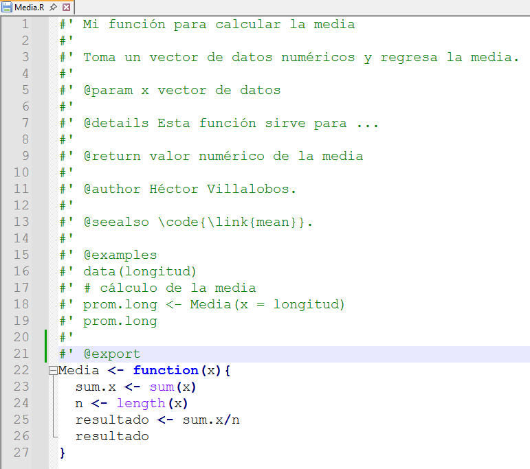
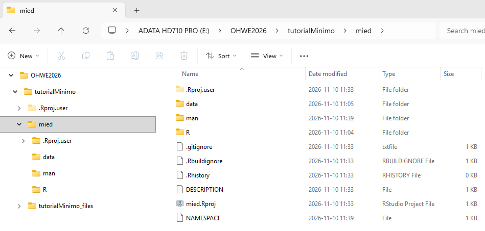
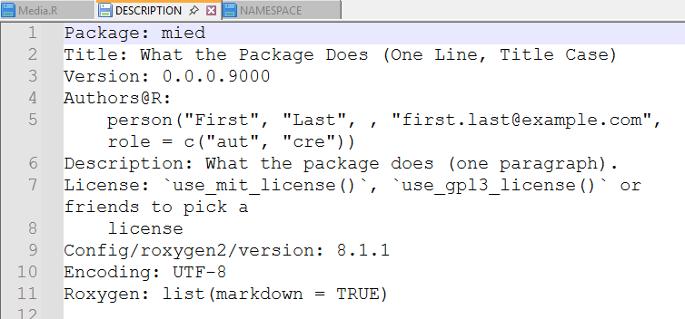
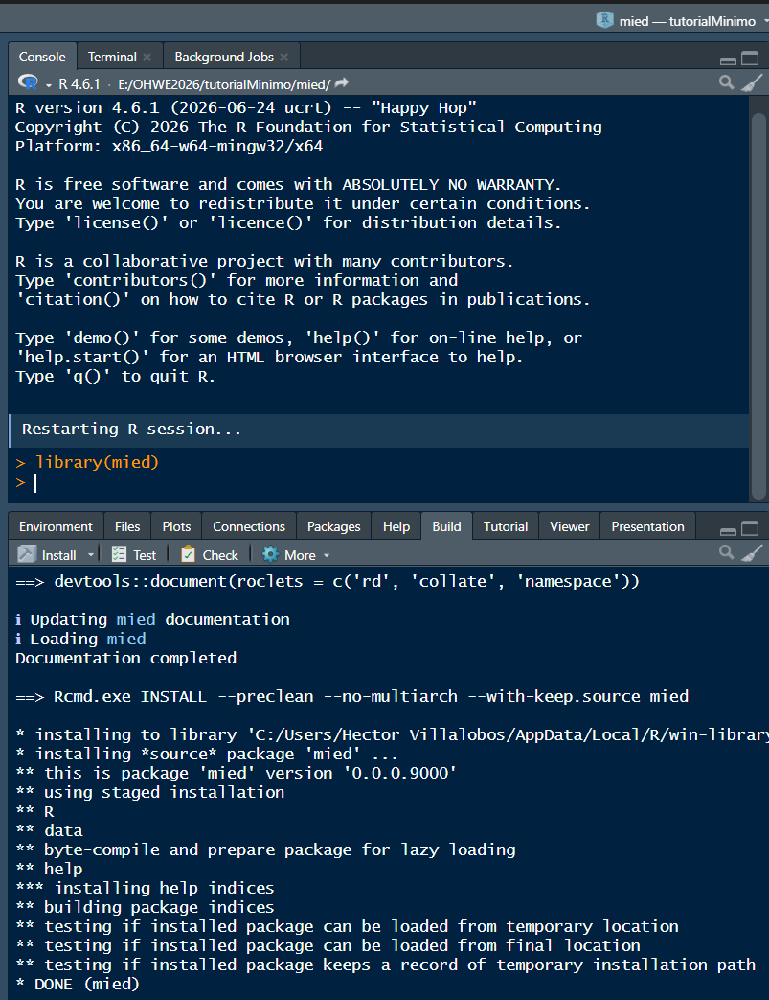

## Introducción

La reutilización de código nos permite ahorrar tiempo cuando necesitamos ejecutar una serie de pasos secuenciales para realizar un determinado análisis, especialmente cuando tenemos que repetirlo para varios conjuntos de datos.

En este escenario, nuestro primer reflejo es copiar el código que tenemos, pegarlo más abajo en nuestro *script* y reemplazar el nombre del objeto utilizado con el que contiene los nuevos datos. El inconveniente de este enfoque es que vamos a acabar con un *script* con demasiadas líneas, lo que lo hace difícil de revisar y mantener, aunado a que si olvidamos reemplazar algo en una parte del código se pueden producir errores difíciles de detectar. Entre más larga y compleja sea la tarea, los errores se pueden multiplicar.

Una mejor solución es convertir nuestro código en una **función**, la cual podemos aplicar a cualquier otro conjunto de datos, simplificando nuestro código de cientos de líneas a unas cuantas.

## Ejemplo

Para ejemplificar esto, vamos a simular una serie de 20 longitudes de cierta especie de pez con media = 150 mm y desviación estándar de 30 = mm.

```{r}
set.seed(7)
longitud <- round(rnorm(20, mean = 150, sd = 30), digits = 0)
longitud
```

Supongamos por un momento que en R no existe una función para promediar estas longitudes. Sabemos que la media $\bar{x}$ resulta de:

$$ \bar{x} = \frac{\displaystyle \sum_{i=1}^n x_i}{n}. $$

donde $x_i$ ( $i=1, 2, \ldots n$. ) es un vector de datos numéricos y $n$ es el número de valores. Este cálculo es por supuesto muy simple, solamente necesitamos sumar todos los valores $x_1 + x_2 + \ldots + x_n$ y dividir entre $n$.

Este cálculo paso a paso sería:

```{r}
Sum.xi <- sum(longitud) # suma de x_i
n <- length(longitud)   # número de datos
promedio <- Sum.xi/n    # cociente
promedio                # resultado
```

Ahora, si también tuviésemos los pesos de los mismos peces y también nos interesa el peso promedio, podríamos hacer:

```{r}
set.seed(7)
peso <- round(rnorm(20, mean = 53, sd = 15), digits = 1)

# Peso promedio
Sum.xi <- sum(peso)   # suma de x_i
n <- length(peso)     # número de datos
promedio <- Sum.xi/n  # cociente
promedio              # resultado
```

Los pasos son idénticos, solo bastó reemplazar `longitud` por `peso` en las dos instrucciones en las que aparece y listo. El inconveniente es que hemos sobrescrito los resultados obtenidos para las longitudes.

## Crear una función para la media

La idea ahora es crear una función que llamaremos `Media()`, la cual aplicaremos a otros conjuntos de datos y de esa manera simplificaremos el *script*.

```{r}
# Función para calcular la media 
Media <- function(x){
  Sum.xi <- sum(x)
  n <- length(x)
  resultado <- Sum.xi/n
  return(resultado)
}
```

Una vez que ejecutamos este código, la función estará disponible en la sesión de R mientras no la cerremos.

```{r}
Media(x = longitud)
Media(peso)
# incluso podemos pasar los valores directamente, sin crear antes un vector
Media(c(5, 10, 7, 9))
```

### Reutilizando la función en otra sesión

La función anterior persiste en el ambiente de R mientras la sesión esté abierta. Para reutilizarla en otra sesión o compartirla con nuestros colegas, podemos guardarla como un archivo independiente `Media.R` y cargarla con `source()`.

```{r}
dump("Media", file = "Media.R")
```

Para probar nuestra función, primero borramos todo el ambiente para que no interfiera con lo nuevo

```{r}
rm(list = ls())
```

luego cargamos la función con `source()`

```{r}
source("Media.R")
```

finalmente, probamos

```{r}
set.seed(21)
peso <- round(rnorm(500, mean = 65, sd = 16), digits = 1)
Media(peso)
```

## Crear un paquete

El pasar de una función a un paquete requiere varios elementos. Primero, debemos documentar nuestra función para que los demás sepamos lo que hace (¡incluido nuestro *yo* del futuro!). Esto normalmente implica generar uno o varios ejemplos de uso, por lo que probablemente también necesitemos agregar datos.

Para la documentación, existen diferentes opciones, una muy conveniente es incluirla en el mismo archivo de la función y procesarla con ayuda del paquete **roxygen2**. Este utiliza comentarios especiales que empiezan con `#'` e incluyen marcas (*tags*), precedidas por el símbolo `@`, que identifican cada parte de la ayuda, por ejemplo `@author`; `@examples`, etc. Esto lo podemos hacer en cualquier editor de textos o bien dentro de RStudio. Guardamos nuestra función modificada en la carpeta `R` de otro directorio, digamos `mied`, que será el nombre del paquete.

{fig-align="center"}

Como puede verse, se incluyó un ejemplo de uso, y para que este funcione, el vector `longitud` se debe incluir en el paquete en la carpeta `data` de `mied`.

```{r, eval = FALSE}
set.seed(56)
longitud <- round(rnorm(20, mean = 150, sd = 30), digits = 0)
save(longitud, file = "./mied/data/longitud.rda", version = 3)
```

Otros archivos necesarios son `DESCRIPTION` y `NAMESPACE` que incluyen información general del paquete, como autor(es), tipo de licencia, etc, y las funciones de otros paquetes que se requieren.

Con la función `create_package()` del paquete **usethis** se pueden generar plantillas de estos documentos, pero para ello será necesario cambiarnos a la carpeta `mied`. **NOTA**: esta función crea algunos archivos y directorios ocultos, además de un "proyecto" de RStudio y lo abre en una nueva sesión, por lo que el siguiente bloque de código no se debe ejecutar dentro de este tutorial, sino copiarlo en un *script* aparte y ejecutarlo ahí.

```{r, eval = FALSE}
# *************** EJECUTAR EN SCRIPT APARTE, NO EN ESTE TUTORIAL***************
setwd("E:/OHWE2026/tutorialMinimo/mied")

library(usethis)

usethis::create_package("D:/OHWE2026/tutorialMinimo/mied")
use_gpl3_license() # incluir licencia GPL3
```

Lo que sigue es procesar la ayuda de la función, que básicamente implica extraer los comentarios y generar un archivo `Media.Rd` que después se procesan en R para generar la ayuda en formato html. El archivo anterior se guarda automáticamente en la carpeta `man` de `mied`.

```{r, eval = FALSE}
library(roxygen2)
roxygenise("mied")
```

La estructura del paquete entonces quedaría así:

{fig-align="center"}

Por último editamos los archivos `DESCRIPTION` y `NAMESPACE` (de ser necesario) con RStudio u otro editor de textos.



Cuando esto se ha completado, podemos probar la instalación de nuestro paquete. Lo más sencillo es

1.  Abrir el proyecto `mied.Rproj`.
2.  Ir a la pestaña *Build.*
3.  Click en *Install.*



Si todo trascurre sin errores, se carga el paquete como cualquier otro y listo:

```{r}
#| message: false
library(mied)
data("longitud")
Media(longitud)
```

invocar ayuda

```{r}
?Media
```

## Comentario final

Cuando consideramos que nuestro paquete puede ser útil para otras personas, es conveniente correr pruebas de que la documentación está completa y que los ejemplos son funcionales. Eso es particularmente importante si queremos someterlo para su publicación en el repositorio de R (CRAN, *The Comprehensive R Archive Network*):

*Build \>\>\> Check*

Después de que las pruebas sean exitosas, generamos el archivo fuente (`mied_0.0.0.9000.tar.gz`), que es el que se envía a CRAN:

*Build \>\>\> More \>\>\> Build Source Package*

o el binario para la plataforma en la que estamos trabajando (`mied_0.0.0.9000.zip`)

*Build \>\>\> More \>\>\> Build Binary Package*

Este último se puede compartir con otros usuarios.

Por último, todo la carpeta de nuestro paquete puede ser subida a nuestro repositorio github.
