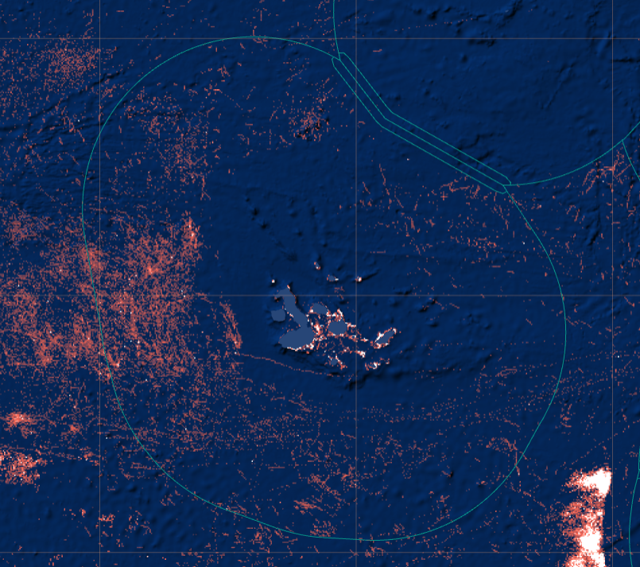
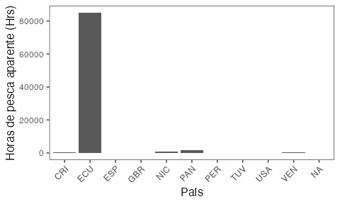
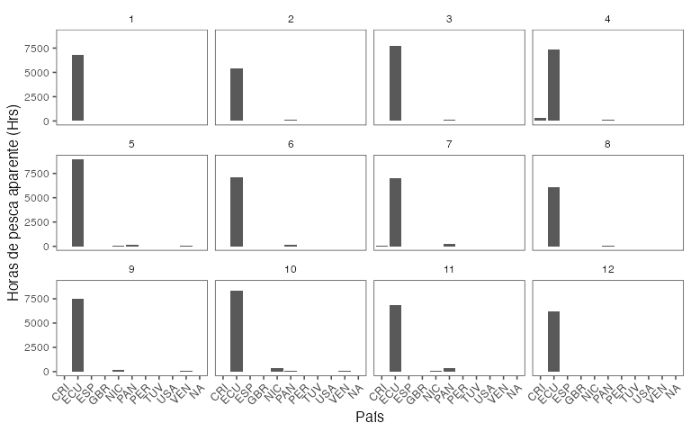
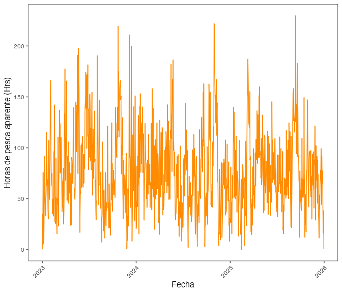
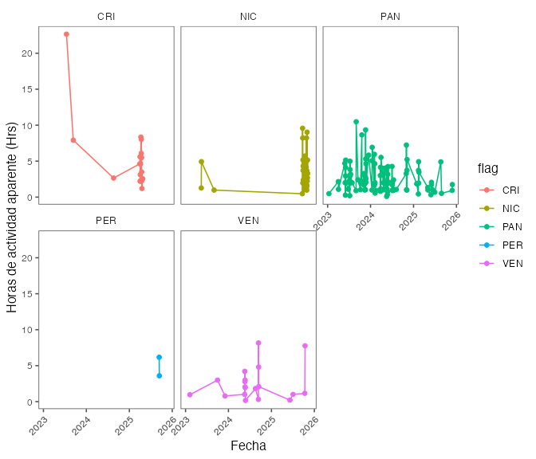
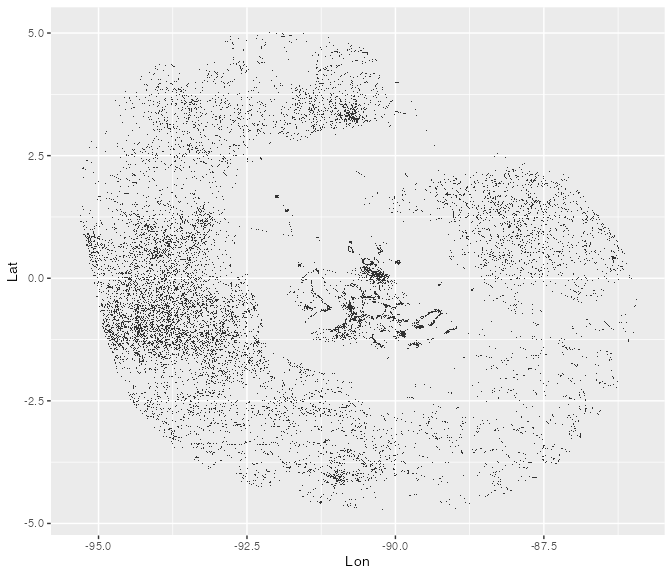
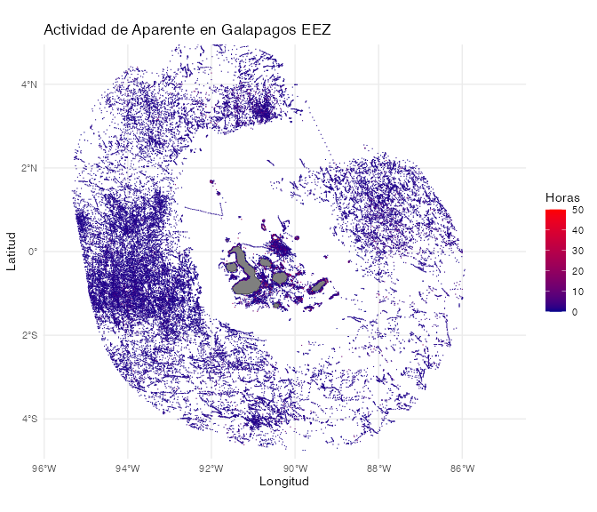
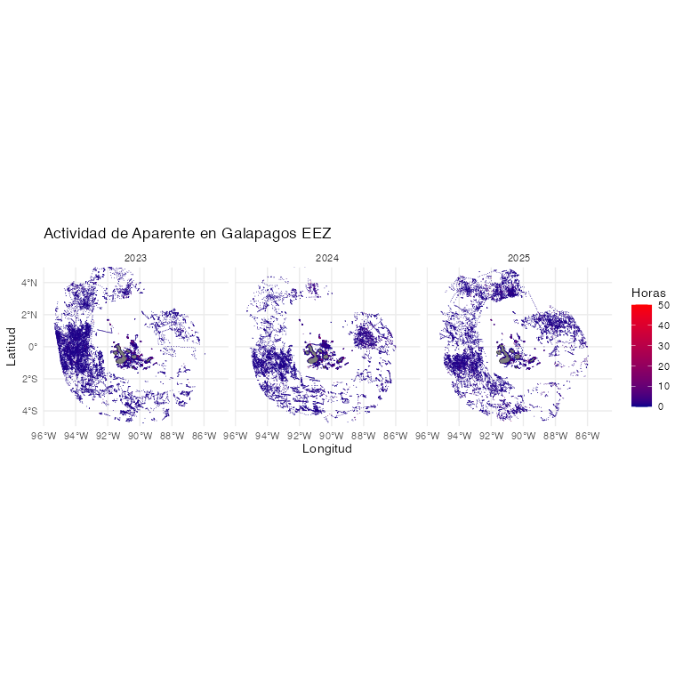

# Trabajando con datos de Global Fishing Watch
Jorge Cornejo-Donoso
noviembre 09, 2026

- [Global Fishing Watch](#global-fishing-watch)
- [Datos](#datos)
  - [Descripción de los datos](#descripción-de-los-datos)
- [Propuesta de Análisis](#propuesta-de-análisis)
- [Configurar paquere gfwR](#configurar-paquere-gfwr)
- [Análisis Paso a paso](#análisis-paso-a-paso)
  - [Actividad de pesca aparente por país de
    registro](#actividad-de-pesca-aparente-por-país-de-registro)
  - [Serie temporal de actividad diaria de pesca
    aparente](#serie-temporal-de-actividad-diaria-de-pesca-aparente)
    - [Para todos los países](#para-todos-los-países)
    - [Para los países principales](#para-los-países-principales)
  - [Análisis espacial de la actividad de pesca
    aparente](#análisis-espacial-de-la-actividad-de-pesca-aparente)
    - [Zonas con mayor actividad de pesca aparente total
      anual](#zonas-con-mayor-actividad-de-pesca-aparente-total-anual)
    - [Zonas con mayor actividad de pesca aparente acumulada por
      año](#zonas-con-mayor-actividad-de-pesca-aparente-acumulada-por-año)
- [Otras funciones de interés](#otras-funciones-de-interés)
  - [Presencia](#presencia)
  - [Información de embarcaciones](#información-de-embarcaciones)
  - [Conocer los Regiones
    disponibles](#conocer-los-regiones-disponibles)
  - [Eventos](#eventos)

# Global Fishing Watch



Global Fishing Watch (GFW) es una organización no gubernamental (ONG)
que busca avanzar en la gobernanza de los océanos a través de una mayor
transparencia de la actividad humana en el mar. Al crear y compartir
públicamente visualizaciones de mapas, datos y herramientas de análisis,
permiten la investigación científica e impulsan una transformación en la
forma en que gestiona el océano.

Global Fishing Watch genera nuevo conocimiento utilizando tecnología de
punta para convertir big data en información procesable. Comparten esa
información públicamente y de forma gratuita para acelerar la ciencia e
impulsar políticas y prácticas más justas e inteligentes que recompensen
el buen comportamiento y protejan la biodiversidad, la pesca y los
medios de subsistencia.

Para más información sobre GFW en <http://www.globalfishingwatch.org>.

Mapa de visualización y acceso a datos
<http://www.globalfishingwatch.org/map>.

# Datos

Global Fishing Watch (GFW) compila una gran cantidad de datos de
posicionamiento de embarcaciones (AIS y VMS), registros de embarcaciones
y otras infraestructuras marinas, y los pone a disposición de los
usuarios a través de sus distintas plataformas. El acceso a estos datos
e información es completamente gratuito y se puede realizar directamente
a través de su [Plataforma WEB](http://www.globalfishingwatch.org/map),
[API](https://globalfishingwatch.org/es/nuestras-api/), [paquete de
R](https://github.com/GlobalFishingWatch/gfwr) y de [librería de
Python](https://pypi.org/project/gfw/).

Si bien la mayoría de los datos de GFW son gratuitos y de libre uso,
para acceder a algunos de ellos es necesario crear una cuenta, proceso
que también es completamente gratuito. Para ello, se debe ingresar a la
página principal de la
[plataforma](http://www.globalfishingwatch.org/map) de GFW y hacer clic
en ícono de registro
() ubicado
en el extremo inferior izquierdo de la pantalla. Luego, se deben seguir
los pasos del proceso de registro para obtener acceso a la descarga de
datos.

Para este ejercicio, vamos a usar los datos de actividad de pesca
aparente, derivado de los dispositivos AIS, para los años 2023, 2024 y
2025, en la [zona economica exclusiva que rodea las islas
Galápagos](https://globalfishingwatch.org/map/index?start=2024-08-12T00%3A00%3A00.000Z&end=2024-11-12T00%3A00%3A00.000Z&longitude=-87.53436510669711&latitude=-0.1438653714849388&zoom=5.3216383206620534&sbO=true&dvIn%5B0%5D%5Bid%5D=presence&dvIn%5B0%5D%5Bcfg%5D%5Bvis%5D=false&dvIn%5B1%5D%5Bid%5D=context-layer-eez&dvIn%5B1%5D%5Bcfg%5D%5Bvis%5D=true&dvIn%5B2%5D%5Bid%5D=vms&dvIn%5B2%5D%5Bcfg%5D%5Bvis%5D=false&dvIn%5B3%5D%5Bid%5D=ais&dvIn%5B3%5D%5Bcfg%5D%5Bvis%5D=true&tV=heatmap)
de la república del Ecuador, tanto como una serie de temporal diaria por
barco y por unidad espacial (0.01°x0.01°) .

## Descripción de los datos

Los datos temporales que vamos a utilizar en este ejercicio son las
horas de pesca aparente diaria por embarcación detectada dentro de esta
área de interés.

Estos datos además contienen información acerca de las embarcaciones,
con nombre, numero IMO, MMSI, bandera, arte de pesca entre otros
(<a href="#tbl-datosTS" class="quarto-xref">Tabla 1</a>).

``` r
data <- read.csv(
  here::here(
    "16-lunes",
    "datos",
    "Temporal_Ecuadorian Exclusive Economic Zone (Galapagos) - 2023-01-01T00_00_00.000Z,2024-01-01T00_00_00.000Z",
    "layer-activity-data-0",
    "public-global-fishing-effort-v5.0.csv"
  )
)


knitr::kable(head(data))
```

<table class="cell">
<colgroup>
<col style="width: 4%" />
<col style="width: 16%" />
<col style="width: 2%" />
<col style="width: 5%" />
<col style="width: 9%" />
<col style="width: 9%" />
<col style="width: 7%" />
<col style="width: 5%" />
<col style="width: 4%" />
<col style="width: 1%" />
<col style="width: 3%" />
<col style="width: 10%" />
<col style="width: 9%" />
<col style="width: 9%" />
</colgroup>
<thead>
<tr>
<th style="text-align: left;">Time.Range</th>
<th style="text-align: left;">Vessel.ID</th>
<th style="text-align: left;">Flag</th>
<th style="text-align: left;">Vessel.Name</th>
<th style="text-align: left;">Entry.Timestamp</th>
<th style="text-align: left;">Exit.Timestamp</th>
<th style="text-align: left;">Gear.Type</th>
<th style="text-align: left;">Vessel.Type</th>
<th style="text-align: right;">MMSI</th>
<th style="text-align: right;">IMO</th>
<th style="text-align: left;">CallSign</th>
<th style="text-align: left;">First.Transmission.Date</th>
<th style="text-align: left;">Last.Transmission.Date</th>
<th style="text-align: right;">Apparent.Fishing.Hours</th>
</tr>
</thead>
<tbody>
<tr>
<td style="text-align: left;">2023-06-18</td>
<td style="text-align: left;">f594e04e3-322a-a564-0018-d27b5ef287d5</td>
<td style="text-align: left;">ECU</td>
<td style="text-align: left;">DONA MARUJA</td>
<td style="text-align: left;">2023-02-03T20:00:00Z</td>
<td style="text-align: left;">2023-11-11T22:00:00Z</td>
<td style="text-align: left;">TUNA_PURSE_SEINES</td>
<td style="text-align: left;">FISHING</td>
<td style="text-align: right;">735058681</td>
<td style="text-align: right;">NA</td>
<td style="text-align: left;">HC5081</td>
<td style="text-align: left;">2021-01-04T16:46:10Z</td>
<td style="text-align: left;">2026-10-10T23:12:53Z</td>
<td style="text-align: right;">21.83</td>
</tr>
<tr>
<td style="text-align: left;">2023-07-05</td>
<td style="text-align: left;">c5f9c52d3-33f0-dcb0-9411-1a2fae43db78</td>
<td style="text-align: left;">ECU</td>
<td style="text-align: left;">B/P.ARIETE</td>
<td style="text-align: left;">2023-05-31T01:00:00Z</td>
<td style="text-align: left;">2023-10-26T23:00:00Z</td>
<td style="text-align: left;">TUNA_PURSE_SEINES</td>
<td style="text-align: left;">FISHING</td>
<td style="text-align: right;">735057785</td>
<td style="text-align: right;">NA</td>
<td style="text-align: left;">HC-4807</td>
<td style="text-align: left;">2021-12-30T15:27:19Z</td>
<td style="text-align: left;">2026-10-14T12:01:35Z</td>
<td style="text-align: right;">23.98</td>
</tr>
<tr>
<td style="text-align: left;">2023-01-12</td>
<td style="text-align: left;">24c31533f-f483-fbe9-7fa0-e62a13f114f7</td>
<td style="text-align: left;">ECU</td>
<td style="text-align: left;">ESPERANZA</td>
<td style="text-align: left;">2023-01-12T12:00:00Z</td>
<td style="text-align: left;">2023-12-22T15:00:00Z</td>
<td style="text-align: left;">FISHING</td>
<td style="text-align: left;">FISHING</td>
<td style="text-align: right;">735059569</td>
<td style="text-align: right;">NA</td>
<td style="text-align: left;">HC6016</td>
<td style="text-align: left;">2016-10-13T15:08:42Z</td>
<td style="text-align: left;">2026-11-05T21:45:33Z</td>
<td style="text-align: right;">1.08</td>
</tr>
<tr>
<td style="text-align: left;">2023-10-04</td>
<td style="text-align: left;">059bcc57d-dc5c-5caa-1f07-c3e8564c2ac7</td>
<td style="text-align: left;">ECU</td>
<td style="text-align: left;">NINA AKEMY</td>
<td style="text-align: left;">2023-01-17T19:00:00Z</td>
<td style="text-align: left;">2023-12-06T18:00:00Z</td>
<td style="text-align: left;">FISHING</td>
<td style="text-align: left;">FISHING</td>
<td style="text-align: right;">735059399</td>
<td style="text-align: right;">NA</td>
<td style="text-align: left;">HC5851</td>
<td style="text-align: left;">2016-11-09T15:05:42Z</td>
<td style="text-align: left;">2026-10-20T12:02:21Z</td>
<td style="text-align: right;">4.79</td>
</tr>
<tr>
<td style="text-align: left;">2023-02-04</td>
<td style="text-align: left;">f594e04e3-322a-a564-0018-d27b5ef287d5</td>
<td style="text-align: left;">ECU</td>
<td style="text-align: left;">DONA MARUJA</td>
<td style="text-align: left;">2023-02-03T20:00:00Z</td>
<td style="text-align: left;">2023-11-11T22:00:00Z</td>
<td style="text-align: left;">TUNA_PURSE_SEINES</td>
<td style="text-align: left;">FISHING</td>
<td style="text-align: right;">735058681</td>
<td style="text-align: right;">NA</td>
<td style="text-align: left;">HC5081</td>
<td style="text-align: left;">2021-01-04T16:46:10Z</td>
<td style="text-align: left;">2026-10-10T23:12:53Z</td>
<td style="text-align: right;">1.69</td>
</tr>
<tr>
<td style="text-align: left;">2023-01-17</td>
<td style="text-align: left;">3604f9b1a-a767-6aac-f931-b6ce5fa101ac</td>
<td style="text-align: left;">ECU</td>
<td style="text-align: left;">EL DELFIN</td>
<td style="text-align: left;">2023-01-05T15:00:00Z</td>
<td style="text-align: left;">2023-11-21T17:00:00Z</td>
<td style="text-align: left;">FISHING</td>
<td style="text-align: left;">FISHING</td>
<td style="text-align: right;">735058694</td>
<td style="text-align: right;">NA</td>
<td style="text-align: left;">HC5991</td>
<td style="text-align: left;">2017-04-28T14:43:42Z</td>
<td style="text-align: left;">2026-09-01T12:03:43Z</td>
<td style="text-align: right;">9.99</td>
</tr>
</tbody>
</table>

En relación a los datos espaciales que se van a utilizar en este
ejercicio son las horas de actividad de pesca aparente diaria por unidad
espacial de 0.01°x0.01° de latitud y longitud
(<a href="#tbl-datosSP" class="quarto-xref">Tabla 2</a>).

``` r
dataSP <- read.csv(
  here::here(
    "16-lunes",
    "datos",
    "SP_Temporal_Ecuadorian Exclusive Economic Zone (Galapagos) - 2023-01-01T00_00_00.000Z,2024-01-01T00_00_00.000Z",
    "layer-activity-data-0",
    "public-global-fishing-effort-v5.0.csv"
  )
)

knitr::kable(head(dataSP))
```

<table class="cell">
<colgroup>
<col style="width: 2%" />
<col style="width: 2%" />
<col style="width: 17%" />
<col style="width: 13%" />
<col style="width: 1%" />
<col style="width: 5%" />
<col style="width: 7%" />
<col style="width: 7%" />
<col style="width: 6%" />
<col style="width: 4%" />
<col style="width: 3%" />
<col style="width: 1%" />
<col style="width: 3%" />
<col style="width: 8%" />
<col style="width: 7%" />
<col style="width: 7%" />
</colgroup>
<thead>
<tr>
<th style="text-align: right;">Lat</th>
<th style="text-align: right;">Lon</th>
<th style="text-align: left;">Time.Range</th>
<th style="text-align: left;">Vessel.ID</th>
<th style="text-align: left;">Flag</th>
<th style="text-align: left;">Vessel.Name</th>
<th style="text-align: left;">Entry.Timestamp</th>
<th style="text-align: left;">Exit.Timestamp</th>
<th style="text-align: left;">Gear.Type</th>
<th style="text-align: left;">Vessel.Type</th>
<th style="text-align: right;">MMSI</th>
<th style="text-align: right;">IMO</th>
<th style="text-align: left;">CallSign</th>
<th style="text-align: left;">First.Transmission.Date</th>
<th style="text-align: left;">Last.Transmission.Date</th>
<th style="text-align: right;">Apparent.Fishing.Hours</th>
</tr>
</thead>
<tbody>
<tr>
<td style="text-align: right;">-0.01</td>
<td style="text-align: right;">-90.27</td>
<td
style="text-align: left;">2023-01-01T00:00:00.000Z,2024-01-01T00:00:00.000Z</td>
<td style="text-align: left;">469e08534-41af-5ce9-5841-d1138375ab0b</td>
<td style="text-align: left;">ECU</td>
<td style="text-align: left;">MEGALODON</td>
<td style="text-align: left;">2023-01-31T03:00:00Z</td>
<td style="text-align: left;">2023-11-23T02:00:00Z</td>
<td style="text-align: left;">FISHING</td>
<td style="text-align: left;">FISHING</td>
<td style="text-align: right;">735059883</td>
<td style="text-align: right;">NA</td>
<td style="text-align: left;">HC6314</td>
<td style="text-align: left;">2019-02-04T11:31:05Z</td>
<td style="text-align: left;">2026-11-07T23:43:07Z</td>
<td style="text-align: right;">0.92</td>
</tr>
<tr>
<td style="text-align: right;">2.73</td>
<td style="text-align: right;">-93.65</td>
<td
style="text-align: left;">2023-01-01T00:00:00.000Z,2024-01-01T00:00:00.000Z</td>
<td style="text-align: left;">facd885ef-fe5d-a83a-d760-c68471fbf289</td>
<td style="text-align: left;">ECU</td>
<td style="text-align: left;">SIEMPRE MI ARCA</td>
<td style="text-align: left;">2023-01-19T10:00:00Z</td>
<td style="text-align: left;">2023-11-08T20:00:00Z</td>
<td style="text-align: left;">DRIFTING_LONGLINES</td>
<td style="text-align: left;">FISHING</td>
<td style="text-align: right;">735058993</td>
<td style="text-align: right;">NA</td>
<td style="text-align: left;">HC5299</td>
<td style="text-align: left;">2020-03-14T21:31:15Z</td>
<td style="text-align: left;">2026-08-22T19:15:03Z</td>
<td style="text-align: right;">1.07</td>
</tr>
<tr>
<td style="text-align: right;">-1.40</td>
<td style="text-align: right;">-93.60</td>
<td
style="text-align: left;">2023-01-01T00:00:00.000Z,2024-01-01T00:00:00.000Z</td>
<td style="text-align: left;">72d5106bd-db22-05cc-5349-685056a09182</td>
<td style="text-align: left;">ECU</td>
<td style="text-align: left;">B/P IKER</td>
<td style="text-align: left;">2023-03-27T20:00:00Z</td>
<td style="text-align: left;">2023-12-15T00:00:00Z</td>
<td style="text-align: left;">DRIFTING_LONGLINES</td>
<td style="text-align: left;">FISHING</td>
<td style="text-align: right;">735059835</td>
<td style="text-align: right;">NA</td>
<td style="text-align: left;">HC6271</td>
<td style="text-align: left;">2023-03-17T14:32:03Z</td>
<td style="text-align: left;">2026-09-22T18:14:05Z</td>
<td style="text-align: right;">0.07</td>
</tr>
<tr>
<td style="text-align: right;">-0.39</td>
<td style="text-align: right;">-90.41</td>
<td
style="text-align: left;">2023-01-01T00:00:00.000Z,2024-01-01T00:00:00.000Z</td>
<td style="text-align: left;">7bf04ede4-4830-a8be-f161-33523af8be7b</td>
<td style="text-align: left;">ECU</td>
<td style="text-align: left;">SAMURAY</td>
<td style="text-align: left;">2023-01-11T17:00:00Z</td>
<td style="text-align: left;">2023-12-11T21:00:00Z</td>
<td style="text-align: left;">FISHING</td>
<td style="text-align: left;">FISHING</td>
<td style="text-align: right;">735059453</td>
<td style="text-align: right;">NA</td>
<td style="text-align: left;">HC5906</td>
<td style="text-align: left;">2017-08-18T15:17:05Z</td>
<td style="text-align: left;">2025-08-22T14:57:22Z</td>
<td style="text-align: right;">1.40</td>
</tr>
<tr>
<td style="text-align: right;">1.99</td>
<td style="text-align: right;">-88.48</td>
<td
style="text-align: left;">2023-01-01T00:00:00.000Z,2024-01-01T00:00:00.000Z</td>
<td style="text-align: left;">f594e04e3-322a-a564-0018-d27b5ef287d5</td>
<td style="text-align: left;">ECU</td>
<td style="text-align: left;">DONA MARUJA</td>
<td style="text-align: left;">2023-02-03T20:00:00Z</td>
<td style="text-align: left;">2023-11-11T22:00:00Z</td>
<td style="text-align: left;">TUNA_PURSE_SEINES</td>
<td style="text-align: left;">FISHING</td>
<td style="text-align: right;">735058681</td>
<td style="text-align: right;">NA</td>
<td style="text-align: left;">HC5081</td>
<td style="text-align: left;">2021-01-04T16:46:10Z</td>
<td style="text-align: left;">2026-10-10T23:12:53Z</td>
<td style="text-align: right;">1.04</td>
</tr>
<tr>
<td style="text-align: right;">0.01</td>
<td style="text-align: right;">-91.58</td>
<td
style="text-align: left;">2023-01-01T00:00:00.000Z,2024-01-01T00:00:00.000Z</td>
<td style="text-align: left;">42018ff85-593e-5a7b-1feb-68e3f774d88d</td>
<td style="text-align: left;">ECU</td>
<td style="text-align: left;">XAVIER</td>
<td style="text-align: left;">2023-01-10T20:00:00Z</td>
<td style="text-align: left;">2023-12-25T23:00:00Z</td>
<td style="text-align: left;">FISHING</td>
<td style="text-align: left;">FISHING</td>
<td style="text-align: right;">735058061</td>
<td style="text-align: right;">NA</td>
<td style="text-align: left;">HC2279</td>
<td style="text-align: left;">2018-04-20T02:35:43Z</td>
<td style="text-align: left;">2026-11-03T21:07:59Z</td>
<td style="text-align: right;">1.50</td>
</tr>
</tbody>
</table>

# Propuesta de Análisis

Los objetivos de este análisis serán:

1.  Identificar los países con mayor actividad de pesca en la ZEE de las
    islas galápagos.
2.  Identificar cuales son los artes de pesca que dominan la actividad
    de pesca aparente dentro de la ZEE de las islas Galápagos.
3.  Obtener una serie temporal diaria de la actividad de pesca aparente.
    1.  Todos los países combinados.
    2.  Para los países principales.
    3.  Para los artes de pesca.
4.  Identificar las zonas con mayor actividad de pesca.
5.  Identificar los periodos (meses) con mayor actividad de pesca.

# Configurar paquere gfwR

``` r
# Check/install remotes
remotes::install_github("GlobalFishingWatch/gfwr",
                        dependencies = TRUE)
library(gfwr)
## https://globalfishingwatch.org/our-apis/tokens
## usethis::edit_r_environ()
#GFW_TOKEN="PASTE_YOUR_TOKEN_HERE"

#key <- gfw_auth()
#key <- Sys.getenv("GFW_TOKEN")
```

# Análisis Paso a paso

## Actividad de pesca aparente por país de registro

Para analizar los datos de pesca aparente por país de registro, tenemos
que agrupar los datos por país y sumar las horas de pesca aparente para
cada uno de ellos.

Esto lo vamos a hacer en dos pasos:

1.  Actividad acumulada de pesca aparente para todos los años por país,
    esto lo presentaremos en un gráfico.  
    1.1. Para esto primero usaremos la `gfw_ais_fishing_hours()` del
    paquete `gfwR`. El API de GFW permite la descarta de datos de
    **hasta 1 año**, por lo que es necesario que dividamos la descarga
    para obtener los 3 años de interés.

``` r
hp <- gfw_ais_fishing_hours(
      spatial_resolution = "HIGH",
      temporal_resolution = "DAILY",
      start_date = "2023-01-01",
      end_date = "2024-01-01",
      region_source = "EEZ",
      region = 8403,
      group_by = "FLAG"
        #(https://www.marineregions.org/eezdetails.php?mrgid=8403)
)
  
## Ahora un ejemplo de como hacer esto con un loop
hp2024_2025 <- data.frame()
for (i in 2024:2025)
{
  hp_temp <- gfw_ais_fishing_hours(
        spatial_resolution = "HIGH",
        temporal_resolution = "DAILY",
        start_date = (paste(i, "-01-01", sep="")),
        end_date = (paste(i+1, "-01-01", sep="")),
        region_source = "EEZ",
        region = 8403,
      group_by = "FLAG") #(https://www.marineregions.org/eezdetails.php?mrgid=8403)
  hp2024_2025 <- rbind(hp2024_2025, hp_temp)
}

data <- rbind(hp, hp2024_2025)
```

    1.2. Con los datos ya descargados, agrupamos todas las embarcaciones que 
    pertenecen al mismo país (`Flag`),
    para luego sumar las  horas de pesca aparente (`Apparent Fishing Hours`).

``` r
hpAnual <- data %>%
  group_by(flag) %>% 
  summarise(hp = sum(`Apparent Fishing Hours`, na.rm=T))
```

Ahora que tenemos el número acumulado de horas podemos crear un gráfico
usando **ggplot**.

``` r
ggplot(hpAnual) +
  geom_col(aes(x=flag, y=hp)) +
  xlab("País") +
  ylab("Horas de pesca aparente (Hrs)") +
  scale_fill_discrete(name = "Tipo") +
  scale_colour_discrete(name = "Tipo") +
  ggthemes::theme_few() +
  theme(axis.text.x = element_text(angle = 45, hjust = 1)) 
```



1.  Actividad mensual de pesca aparente por de pesca por país y lo
    presentaremos en un gráfico.

    El proceso en este caso es similar, pero ahora se debe agrupar
    también por el `mes`. Para esto es necesario crear la columna
    **mes** y **year** (que usaremos más tarde), esto lo hacemos usando
    la funcion `dplr::mutate` y `lubridate::month`.

``` r
hpplot <- data %>%
  mutate(mes = month(`Time Range`),
         year = year(`Time Range`)) %>%  ## <- Obtenemos el mes desde la columna de la fecha
  group_by(mes, flag) %>% ## Incluimos el mes en el grouping
  summarise(hp = sum(`Apparent Fishing Hours`, na.rm=T))

ggplot(hpplot) +
  geom_col(aes(x=flag, y=hp)) +
  xlab("País") +
  ylab("Horas de pesca aparente (Hrs)") +
  scale_fill_discrete(name = "Tipo") +
  scale_colour_discrete(name = "Tipo") +
  ggthemes::theme_few() +
  theme(axis.text.x = element_text(angle = 45, hjust = 1)) +
  facet_wrap(~mes) ## <- Esto permite crear el grafico separando los meses
```



## Serie temporal de actividad diaria de pesca aparente

### Para todos los países

Ahora vamos a analizar cómo varía la actividad de pesca aparente a nivel
diario. Para esto, compararemos primero la actividad total y luego la
actividad por país.

En este caso, debemos agrupar la actividad de pesca aparente por día,
sumando las horas individuales de cada embarcación. Posteriormente,
podemos realizar este mismo análisis separando los datos por país y/o
arte de pesca.

En los gráficos anteriores vimos que Ecuador es el país que presenta la
mayor actividad de pesca aparente en esta área. Por esta razón,
utilizaremos únicamente las embarcaciones ecuatorianas para este
ejemplo. Para ello, filtraremos los datos utilizando la función
`dplyr::filter`.

``` r
hpDiaEcu <- data %>%
  filter(flag == "ECU") %>%  ## Aqui es donde filtramos para barcos de ecuador
  group_by(`Time Range`) %>% ## Incluimos el mes en el grouping
  summarise(hp = sum(`Apparent Fishing Hours`, na.rm=T))
```

Y como serie temporal.

``` r
ggplot(hpDiaEcu) +
  geom_line(aes(x=as.Date(`Time Range`), y=hp), col="darkorange") +
  xlab("Fecha") +
  ylab("Horas de pesca aparente (Hrs)") +
  ggthemes::theme_few() +
  theme(axis.text.x = element_text(angle = 45, hjust = 1))
```



### Para los países principales

Ahora elaboraremos este gráfico temporal para los países (excluido
Ecuador) que presentan la mayor actividad de pesca aparente en la ZEE de
las islas Galápagos.

Para ello, necesitamos excluir las embarcaciones con bandera de Ecuador
(`filter(Flag != "ECU")`) y aquellas sin bandera conocida
(`!is.na(Flag)`).

Con estos datos, calculamos el total de horas de actividad de pesca
aparente por país.

``` r
porPais <- data %>%
  filter(flag != "ECU", flag != "",
         !is.na(flag)) %>%  ## Eliminamos embarcaciones de Ecuador y aquellas sin bandera
  group_by(flag) %>% ## Incluimos el mes en el grouping
  summarise(hp = sum(`Apparent Fishing Hours`, na.rm=T)) %>% 
  arrange(desc(hp))

knitr::kable(porPais)
```

<table class="cell">
<thead>
<tr>
<th style="text-align: left;">flag</th>
<th style="text-align: right;">hp</th>
</tr>
</thead>
<tbody>
<tr>
<td style="text-align: left;">PAN</td>
<td style="text-align: right;">1595.01</td>
</tr>
<tr>
<td style="text-align: left;">NIC</td>
<td style="text-align: right;">655.34</td>
</tr>
<tr>
<td style="text-align: left;">CRI</td>
<td style="text-align: right;">407.74</td>
</tr>
<tr>
<td style="text-align: left;">VEN</td>
<td style="text-align: right;">284.22</td>
</tr>
<tr>
<td style="text-align: left;">PER</td>
<td style="text-align: right;">33.27</td>
</tr>
<tr>
<td style="text-align: left;">USA</td>
<td style="text-align: right;">3.56</td>
</tr>
<tr>
<td style="text-align: left;">GBR</td>
<td style="text-align: right;">2.99</td>
</tr>
<tr>
<td style="text-align: left;">ESP</td>
<td style="text-align: right;">1.67</td>
</tr>
<tr>
<td style="text-align: left;">TUV</td>
<td style="text-align: right;">1.26</td>
</tr>
</tbody>
</table>

En la <a href="#tbl-hpXPais" class="quarto-xref">Tabla 3</a> vemos que
la actividad de pesca aparente de Estados Unidos (USA), Reino Unido
(GBR), España (ESP) y Tuvalu (TUV) son muy bajar y pueden corresponder a
falsos positivos, es por esto que los eliminaremos del análisis.

``` r
diaNoEcu <- data %>%
  filter(flag == c("PAN", "NIC" ,"CRI", "VEN", "PER")) %>%
  group_by(flag, `Time Range`) %>% 
  summarise(hp = sum(`Apparent Fishing Hours`, na.rm=T))
```

``` r
ggplot(diaNoEcu) +
  geom_point(aes(x=as.Date(`Time Range`), y=hp, col = flag)) +
  geom_line(aes(x=as.Date(`Time Range`), y=hp, col = flag)) +
  xlab("Fecha") +
  ylab("Horas de actividad aparente (Hrs)") +
  ggthemes::theme_few() +
  theme(axis.text.x = element_text(angle = 45, hjust = 1)) +
  facet_wrap(~flag)
```



## Análisis espacial de la actividad de pesca aparente

### Zonas con mayor actividad de pesca aparente total anual

Aqui agrupamos los datos espaciales, sumando las horas de pesca aparente
para los 3 años, en cada una de las celdas y luego lo presentamos.

``` r
spAnual <- data %>% 
  group_by(Lat, Lon) %>% 
  summarise(hp = sum(`Apparent Fishing Hours`, na.rm=T))
```

Y presentamos el mapa.

``` r
ggplot(spAnual) +
  geom_tile(aes(x=Lon, y=Lat, z=hp))
```



Esta imágen se ve bastante mal, es necestio agregar las islas y, en
términos generales, mejorar la presentación.

``` r
# Get Galapagos land data

spAnual_sf <- st_as_sf(spAnual, coords = c("Lon", "Lat"), crs = 4326) # Lo transforma a un                                                              objeto geográfico

galapagos_land <- ne_countries(scale = "medium", returnclass = "sf") %>%
  filter(name == "Ecuador")  # Filter for Ecuador, as Galapagos belongs to Ecuador

ggplot() +
  # Add base map
  geom_sf(data = galapagos_land, fill = "grey50", color = "black") +
  # Add fishing data
  geom_tile(data = spAnual, aes(x = Lon, y = Lat, fill = hp, col=hp)) +
  # Define color gradient
  scale_color_gradient(low = "darkblue", high = "red", name = "Horas", limits = c(0, 50)) +
  scale_fill_gradient(low = "darkblue", high = "red", name = "Horas", limits = c(0, 50)) +
  scale_size_continuous(name = "Horas de Actividad Aparente") +
  labs(
    title = "Actividad de Aparente en Galapagos EEZ",
    x = "Longitud",
    y = "Latitud"
  ) +
  theme_minimal() +
  coord_sf(xlim = c(-95.5, -85), ylim = c(-4.5, 4.5))  # Adjust limits to Galapagos region
```



### Zonas con mayor actividad de pesca aparente acumulada por año

El mismo gráfico, pero separado por años.

``` r
spMensual <- data %>% 
  mutate(year = year(`Time Range`)) %>% 
  group_by(year, Lat, Lon) %>% 
  summarise(hp = sum(`Apparent Fishing Hours`, na.rm=T))

ggplot() +
  geom_sf(data = galapagos_land, fill = "grey50", color = "black") +
  geom_tile(data = spMensual, aes(x = Lon, y = Lat, fill = hp, col=hp)) +
  scale_color_gradient(low = "darkblue", high = "red", name = "Horas", limits = c(0, 50)) +
  scale_fill_gradient(low = "darkblue", high = "red", name = "Horas", limits = c(0, 50)) +
  scale_size_continuous(name = "Horas de Actividad Aparente") +
  labs(
    title = "Actividad de Aparente en Galapagos EEZ",
    x = "Longitud", y = "Latitud" ) +
  theme_minimal() +
  coord_sf(xlim = c(-95.5, -85), ylim = c(-4.5, 4.5))  +# Adjust limits to Galapagos region
  facet_wrap(~year)
```



# Otras funciones de interés

## Presencia

Si quisieramos conocer los potenciales riesgos de colición con mamíferos
marinos podriamos hacer algo como esto.

``` r
aFiltrar <- c("speed = '10-15'", "speed = '15-25'",
              "speed = '>25'")

presSpeed <- data.frame()
  
for (i in aFiltrar)
{
temp <- gfw_ais_presence(spatial_resolution = "HIGH",
  temporal_resolution = "DAILY",
  start_date = "2026-01-01",
  end_date = "2026-07-01",
  region_source = "EEZ",
  group_by = "FLAG",
  region = 8403,
  key = gfw_auth(),
  filter_by = i)

presSpeed <- rbind(presSpeed, temp)
}
```

## Información de embarcaciones

``` r
gfwr::gfw_vessel_info(query = 735060382,
                      search_type = "search") $selfReportedInfo |> 
  kableExtra::kable()
```

<table>
<colgroup>
<col style="width: 3%" />
<col style="width: 20%" />
<col style="width: 5%" />
<col style="width: 4%" />
<col style="width: 5%" />
<col style="width: 2%" />
<col style="width: 4%" />
<col style="width: 2%" />
<col style="width: 8%" />
<col style="width: 8%" />
<col style="width: 5%" />
<col style="width: 6%" />
<col style="width: 11%" />
<col style="width: 11%" />
</colgroup>
<thead>
<tr>
<th style="text-align: right;">index</th>
<th style="text-align: left;">vesselId</th>
<th style="text-align: left;">ssvid</th>
<th style="text-align: left;">shipname</th>
<th style="text-align: left;">nShipname</th>
<th style="text-align: left;">flag</th>
<th style="text-align: left;">callsign</th>
<th style="text-align: left;">imo</th>
<th style="text-align: right;">messagesCounter</th>
<th style="text-align: right;">positionsCounter</th>
<th style="text-align: left;">sourceCode</th>
<th style="text-align: left;">matchFields</th>
<th style="text-align: left;">transmissionDateFrom</th>
<th style="text-align: left;">transmissionDateTo</th>
</tr>
</thead>
<tbody>
<tr>
<td style="text-align: right;">1</td>
<td style="text-align: left;">1fe5f27d2-26b1-8781-75f5-24ac8162b0fc</td>
<td style="text-align: left;">735060382</td>
<td style="text-align: left;">DAYANARA</td>
<td style="text-align: left;">DAYANARA</td>
<td style="text-align: left;">ECU</td>
<td style="text-align: left;">HC6683</td>
<td style="text-align: left;">NA</td>
<td style="text-align: right;">695645</td>
<td style="text-align: right;">121510</td>
<td style="text-align: left;">AIS</td>
<td style="text-align: left;">NO_MATCH</td>
<td style="text-align: left;">2023-06-09T22:16:28Z</td>
<td style="text-align: left;">2026-11-07T09:50:46Z</td>
</tr>
</tbody>
</table>

``` r
#gfwr::gfw_vessel_info(ids = as.vector(presSpeed$`Vessel ID`[3]),
#                      search_type = "id")$combinedSourcesInfo |> 
#  kableExtra::kable()
```

## Conocer los Regiones disponibles

``` r
gfw_regions(region_source = "EEZ", key = gfw_auth()) |> 
    filter(iso == "CHL")
```

    # A tibble: 3 × 5
      iso   label                               id GEONAME                  POL_TYPE
      <chr> <chr>                            <dbl> <chr>                    <chr>   
    1 CHL   Chile                             8465 Chilean Exclusive Econo… 200NM   
    2 CHL   Islas San Félix and San Ambrosio 22756 Chilean Exclusive Econo… 200NM   
    3 CHL   Easter Island                    21787 Chilean Exclusive Econo… 200NM   

``` r
gfw_regions(region_source = "MPA", key = gfw_auth()) |> 
  filter(str_detect(label, "Juan Fernández")) |> 
  kableExtra::kable()
```

<table>
<colgroup>
<col style="width: 86%" />
<col style="width: 13%" />
</colgroup>
<thead>
<tr>
<th style="text-align: left;">label</th>
<th style="text-align: left;">id</th>
</tr>
</thead>
<tbody>
<tr>
<td style="text-align: left;">Archipiélago Juan Fernández (RB) - Reserva
Biósfera</td>
<td style="text-align: left;">121</td>
</tr>
<tr>
<td style="text-align: left;">Mar de Juan Fernández - Área de
Conservación de Múltiples Usos</td>
<td style="text-align: left;">555786067</td>
</tr>
<tr>
<td style="text-align: left;">Mar de Juan Fernández (PN) - Parque
Nacional</td>
<td style="text-align: left;">555786068</td>
</tr>
</tbody>
</table>

## Eventos

``` r
gfw_event(
  event_type = "FISHING", #"ENCOUNTER", "GAP", "LOITERING", "PORT_VISIT",
  start_date = "2026-01-01",
  end_date = "2026-02-01",
  sort = "+start",
  #flags = "ECU",
  region_source = "EEZ",
  region = 8403
)[1:10,] |> kableExtra::kable()
```

    [1] "Downloading 186 events from GFW"

<table>
<colgroup>
<col style="width: 2%" />
<col style="width: 2%" />
<col style="width: 3%" />
<col style="width: 1%" />
<col style="width: 0%" />
<col style="width: 0%" />
<col style="width: 47%" />
<col style="width: 4%" />
<col style="width: 4%" />
<col style="width: 3%" />
<col style="width: 1%" />
<col style="width: 1%" />
<col style="width: 1%" />
<col style="width: 1%" />
<col style="width: 2%" />
<col style="width: 1%" />
<col style="width: 18%" />
</colgroup>
<thead>
<tr>
<th style="text-align: left;">start</th>
<th style="text-align: left;">end</th>
<th style="text-align: left;">eventId</th>
<th style="text-align: left;">eventType</th>
<th style="text-align: right;">lat</th>
<th style="text-align: right;">lon</th>
<th style="text-align: left;">regions</th>
<th style="text-align: left;">boundingBox</th>
<th style="text-align: left;">distances</th>
<th style="text-align: left;">vesselId</th>
<th style="text-align: left;">vessel_name</th>
<th style="text-align: left;">vessel_ssvid</th>
<th style="text-align: left;">vessel_flag</th>
<th style="text-align: left;">vessel_type</th>
<th style="text-align: left;">vessel_publicAuthorizations</th>
<th style="text-align: left;">vessel_nextPort</th>
<th style="text-align: left;">event_info</th>
</tr>
</thead>
<tbody>
<tr>
<td style="text-align: left;">2026-01-01 14:18:49</td>
<td style="text-align: left;">2026-01-01 22:10:02</td>
<td style="text-align: left;">2a66784c8ec33b772dd92435772340b3</td>
<td style="text-align: left;">fishing</td>
<td style="text-align: right;">0.2761</td>
<td style="text-align: right;">-91.6170</td>
<td style="text-align: left;">11753 , 191 , 10708 , 8403 , IWC , ACAP ,
CPPS , IATTC , 87.1 , 87 , 87.1.3 , 87 , ETTP_10 , ETTP_8 ,
14SETTPO222222IMMA, AIECU1 , AIHSTREATY36 , AIECU2 , AIHSTREATY2 ,
AIECU192 , AIHSEBSA151 , AIHSEBSA152 , AIHSTREATY28</td>
<td style="text-align: left;">-91.625253, 0.270360, -91.614725,
0.282635</td>
<td style="text-align: left;">24.000000, 25.000000, 1.111936,
1.111949</td>
<td style="text-align: left;">ce65a92fa-ae1f-d30e-852f-2b467d6b676d</td>
<td style="text-align: left;">KATTY TATIANA</td>
<td style="text-align: left;">735059649</td>
<td style="text-align: left;">ECU</td>
<td style="text-align: left;">fishing</td>
<td style="text-align: left;">false, IATTC</td>
<td style="text-align: left;">NA</td>
<td style="text-align: left;">6.15730504298335 , 1.72978723404255 ,
FALSE , not_matching_relevant_public_authorization</td>
</tr>
<tr>
<td style="text-align: left;">2026-01-03 13:25:18</td>
<td style="text-align: left;">2026-01-03 14:04:23</td>
<td style="text-align: left;">69f00f856a909868a6bf5a61b6e6f44a</td>
<td style="text-align: left;">fishing</td>
<td style="text-align: right;">-1.1511</td>
<td style="text-align: right;">-89.9290</td>
<td style="text-align: left;">10708 , 11753 , 191 , 8403 , IWC , ACAP ,
CPPS , IATTC , 87.1 , 87 , 87.1.3 , 87 , ETTP_10 , ETTP_8 ,
14SETTPO222222IMMA, AIECU1 , AIHSTREATY36 , AIHSTREATY28 , AIHSTREATY2 ,
AIHSEBSA152 , AIHSEBSA151 , AIECU192 , AIECU2</td>
<td style="text-align: left;">-89.931175, -1.151833, -89.927463,
-1.150030</td>
<td style="text-align: left;">31.00000, 31.00000, 37.61983,
36.70532</td>
<td style="text-align: left;">06d07de38-85b3-bf93-a201-4684c3e95276</td>
<td style="text-align: left;">SAN JOSE</td>
<td style="text-align: left;">735060175</td>
<td style="text-align: left;">ECU</td>
<td style="text-align: left;">fishing</td>
<td style="text-align: left;">false, IATTC</td>
<td style="text-align: left;">NA</td>
<td style="text-align: left;">0.878012575028948 , 1.83636363636364 ,
FALSE , not_matching_relevant_public_authorization</td>
</tr>
<tr>
<td style="text-align: left;">2026-01-03 14:34:17</td>
<td style="text-align: left;">2026-01-03 22:34:22</td>
<td style="text-align: left;">e998bfe9ee1cf2358d3d6f25bd6b6f80</td>
<td style="text-align: left;">fishing</td>
<td style="text-align: right;">-1.2079</td>
<td style="text-align: right;">-89.9887</td>
<td style="text-align: left;">10708 , 11753 , 191 , 8403 , CPPS , IWC ,
IATTC , ACAP , 87 , 87.1.3 , 87.1 , 87 , ETTP_8 , ETTP_10 ,
14SETTPO222222IMMA, AIECU2 , AIHSTREATY36 , AIHSTREATY2 , AIECU192 ,
AIHSTREATY28 , AIHSEBSA151 , AIHSEBSA152 , AIECU1</td>
<td style="text-align: left;">-90.013932, -1.212042, -89.980582,
-1.197198</td>
<td style="text-align: left;">32.00000, 32.00000, 33.44389,
37.37101</td>
<td style="text-align: left;">06d07de38-85b3-bf93-a201-4684c3e95276</td>
<td style="text-align: left;">SAN JOSE</td>
<td style="text-align: left;">735060175</td>
<td style="text-align: left;">ECU</td>
<td style="text-align: left;">fishing</td>
<td style="text-align: left;">false, IATTC</td>
<td style="text-align: left;">NA</td>
<td style="text-align: left;">10.0773859686119 , 1.33669724770642 ,
FALSE , not_matching_relevant_public_authorization</td>
</tr>
<tr>
<td style="text-align: left;">2026-01-04 12:07:38</td>
<td style="text-align: left;">2026-01-04 20:55:46</td>
<td style="text-align: left;">9b837daf96b870bdfa3b61f951550f03</td>
<td style="text-align: left;">fishing</td>
<td style="text-align: right;">-1.1441</td>
<td style="text-align: right;">-89.9083</td>
<td style="text-align: left;">191 , 10708 , 11753 , 8403 , IATTC , CPPS
, IWC , ACAP , 87.1 , 87 , 87.1.3 , 87 , ETTP_10 , ETTP_8 ,
14SETTPO222222IMMA, AIECU192 , AIHSEBSA151 , AIHSTREATY28 , AIHSEBSA152
, AIHSTREATY2 , AIHSTREATY36 , AIECU1 , AIECU2</td>
<td style="text-align: left;">-89.931683, -1.163103, -89.882358,
-1.128487</td>
<td style="text-align: left;">31.00000, 31.00000, 37.00675,
35.38644</td>
<td style="text-align: left;">06d07de38-85b3-bf93-a201-4684c3e95276</td>
<td style="text-align: left;">SAN JOSE</td>
<td style="text-align: left;">735060175</td>
<td style="text-align: left;">ECU</td>
<td style="text-align: left;">fishing</td>
<td style="text-align: left;">false, IATTC</td>
<td style="text-align: left;">NA</td>
<td style="text-align: left;">26.1925994557017 , 2.30807453416149 ,
FALSE , not_matching_relevant_public_authorization</td>
</tr>
<tr>
<td style="text-align: left;">2026-01-04 14:19:42</td>
<td style="text-align: left;">2026-01-04 15:04:46</td>
<td style="text-align: left;">5755d93d80bc20ce6121acfec65ed571</td>
<td style="text-align: left;">fishing</td>
<td style="text-align: right;">-0.8377</td>
<td style="text-align: right;">-90.8240</td>
<td style="text-align: left;">10708 , 191 , 11753 , 8403 , IWC , IATTC ,
CPPS , ACAP , 87.1.3 , 87.1 , 87 , 87 , ETTP_8 , ETTP_10 ,
14SETTPO222222IMMA, AIECU192 , AIECU1 , AIHSEBSA151 , AIHSTREATY2 ,
AIECU2 , AIHSTREATY36 , AIHSTREATY28 , AIHSEBSA152</td>
<td style="text-align: left;">-90.830448, -0.851612, -90.816620,
-0.823882</td>
<td style="text-align: left;">0.00000, 2.00000, 18.09998, 22.01412</td>
<td style="text-align: left;">b0b40ba5a-a4eb-127b-471f-8dc5aaafc03e</td>
<td style="text-align: left;">SANDRA</td>
<td style="text-align: left;">735059469</td>
<td style="text-align: left;">ECU</td>
<td style="text-align: left;">fishing</td>
<td style="text-align: left;">false, IATTC</td>
<td style="text-align: left;">NA</td>
<td style="text-align: left;">3.55912198282467 , 5.02857142857143 ,
FALSE , not_matching_relevant_public_authorization</td>
</tr>
<tr>
<td style="text-align: left;">2026-01-05 14:25:26</td>
<td style="text-align: left;">2026-01-05 17:15:08</td>
<td style="text-align: left;">218803369d4594c5ccc3347562387fb8</td>
<td style="text-align: left;">fishing</td>
<td style="text-align: right;">-0.8574</td>
<td style="text-align: right;">-90.6487</td>
<td style="text-align: left;">191 , 10708 , 11753 , 8403 , IWC , CPPS ,
IATTC , ACAP , 87 , 87.1 , 87.1.3 , 87 , ETTP_10 , ETTP_8 ,
14SETTPO222222IMMA, AIHSEBSA151 , AIHSEBSA152 , AIHSTREATY2 , AIECU2 ,
AIHSTREATY36 , AIECU192 , AIHSTREATY28 , AIECU1</td>
<td style="text-align: left;">-90.652780, -0.861983, -90.643303,
-0.852815</td>
<td style="text-align: left;">13.00000, 14.00000, 35.15888,
36.57210</td>
<td style="text-align: left;">5f46ecfd0-050a-9d9c-8c05-917c2c47a022</td>
<td style="text-align: left;">ASI ES LA VIDA II</td>
<td style="text-align: left;">735059497</td>
<td style="text-align: left;">ECU</td>
<td style="text-align: left;">fishing</td>
<td style="text-align: left;">false, IATTC</td>
<td style="text-align: left;">NA</td>
<td style="text-align: left;">3.85370480414967 , 1.13695652173913 ,
FALSE , not_matching_relevant_public_authorization</td>
</tr>
<tr>
<td style="text-align: left;">2026-01-05 14:44:59</td>
<td style="text-align: left;">2026-01-06 00:06:08</td>
<td style="text-align: left;">a17c8bb8580bd15de369a1d8f096fb88</td>
<td style="text-align: left;">fishing</td>
<td style="text-align: right;">0.2749</td>
<td style="text-align: right;">-91.6184</td>
<td style="text-align: left;">191 , 10708 , 11753 , 8403 , IWC , CPPS ,
IATTC , ACAP , 87.1 , 87.1.3 , 87 , 87 , ETTP_8 , ETTP_10 ,
14SETTPO222222IMMA, AIECU1 , AIHSTREATY28 , AIECU192 , AIHSTREATY2 ,
AIHSTREATY36 , AIHSEBSA152 , AIHSEBSA151 , AIECU2</td>
<td style="text-align: left;">-91.626547, 0.258303, -91.613542,
0.281323</td>
<td style="text-align: left;">23.000000, 25.000000, 2.486389,
1.111949</td>
<td style="text-align: left;">59d0ac704-44ce-4293-9b51-d53177ba30e5</td>
<td style="text-align: left;">OCEAN LIFE</td>
<td style="text-align: left;">735059677</td>
<td style="text-align: left;">ECU</td>
<td style="text-align: left;">fishing</td>
<td style="text-align: left;">false, IATTC</td>
<td style="text-align: left;">NA</td>
<td style="text-align: left;">18.4139277557877 , 1.41777777777778 ,
FALSE , not_matching_relevant_public_authorization</td>
</tr>
<tr>
<td style="text-align: left;">2026-01-05 17:27:02</td>
<td style="text-align: left;">2026-01-05 18:37:05</td>
<td style="text-align: left;">b078cd04b81ead719d60fa3edecfad47</td>
<td style="text-align: left;">fishing</td>
<td style="text-align: right;">-1.3526</td>
<td style="text-align: right;">-89.6188</td>
<td style="text-align: left;">191 , 10708 , 11753 , 8403 , ACAP , IWC ,
IATTC , CPPS , 87.1.3 , 87.1 , 87 , 87 , ETTP_10 , ETTP_8 ,
14SETTPO222222IMMA, AIHSEBSA152 , AIHSTREATY2 , AIHSTREATY28 , AIECU192
, AIECU2 , AIHSTREATY36 , AIECU1 , AIHSEBSA151</td>
<td style="text-align: left;">-89.623247, -1.360912, -89.614525,
-1.344772</td>
<td style="text-align: left;">1.000000, 2.000000, 4.008414,
4.446572</td>
<td style="text-align: left;">24c31533f-f483-fbe9-7fa0-e62a13f114f7</td>
<td style="text-align: left;">ESPERANZA</td>
<td style="text-align: left;">735059569</td>
<td style="text-align: left;">ECU</td>
<td style="text-align: left;">fishing</td>
<td style="text-align: left;">false, IATTC</td>
<td style="text-align: left;">NA</td>
<td style="text-align: left;">2.0446293983504 , 0.8 , FALSE ,
not_matching_relevant_public_authorization</td>
</tr>
<tr>
<td style="text-align: left;">2026-01-05 18:15:08</td>
<td style="text-align: left;">2026-01-06 00:52:45</td>
<td style="text-align: left;">3f4cf2def3a0c68e88c8588ca8322a59</td>
<td style="text-align: left;">fishing</td>
<td style="text-align: right;">-0.7962</td>
<td style="text-align: right;">-90.6720</td>
<td style="text-align: left;">10708 , 11753 , 191 , 8403 , IATTC , ACAP
, CPPS , IWC , 87.1 , 87 , 87.1.3 , 87 , ETTP_8 , ETTP_10 ,
14SETTPO222222IMMA, AIHSTREATY28 , AIECU192 , AIHSEBSA151 , AIHSTREATY36
, AIHSEBSA152 , AIECU2 , AIHSTREATY2 , AIECU1</td>
<td style="text-align: left;">-90.676843, -0.802952, -90.658878,
-0.791298</td>
<td style="text-align: left;">12.00000, 14.00000, 35.85605,
38.20952</td>
<td style="text-align: left;">5f46ecfd0-050a-9d9c-8c05-917c2c47a022</td>
<td style="text-align: left;">ASI ES LA VIDA II</td>
<td style="text-align: left;">735059497</td>
<td style="text-align: left;">ECU</td>
<td style="text-align: left;">fishing</td>
<td style="text-align: left;">false, IATTC</td>
<td style="text-align: left;">NA</td>
<td style="text-align: left;">3.9157279475296 , 0.817045454545455 ,
FALSE , not_matching_relevant_public_authorization</td>
</tr>
<tr>
<td style="text-align: left;">2026-01-06 00:05:35</td>
<td style="text-align: left;">2026-01-07 14:25:09</td>
<td style="text-align: left;">c7aad910b53b31682c6e3e6dc8c73cb9</td>
<td style="text-align: left;">fishing</td>
<td style="text-align: right;">0.3096</td>
<td style="text-align: right;">-90.4031</td>
<td style="text-align: left;">10708 , 191 , 11753 , 8403 , IWC , ACAP ,
CPPS , IATTC , 87.1.3 , 87.1 , 87 , 87 , ETTP_10 , ETTP_8 ,
14SETTPO222222IMMA, AIHSTREATY28 , AIECU2 , AIECU192 , AIHSEBSA152 ,
AIHSTREATY2 , AIHSTREATY36 , AIHSEBSA151 , AIECU1</td>
<td style="text-align: left;">-90.406492, 0.301565, -90.394458,
0.322148</td>
<td style="text-align: left;">1.00000, 2.00000, 51.16100, 50.04929</td>
<td style="text-align: left;">e6326c1bc-ca2a-7de7-b2a3-baf6bfef6b55</td>
<td style="text-align: left;">CRISTOFHER</td>
<td style="text-align: left;">735059488</td>
<td style="text-align: left;">ECU</td>
<td style="text-align: left;">fishing</td>
<td style="text-align: left;">false, IATTC</td>
<td style="text-align: left;">NA</td>
<td style="text-align: left;">30.8406221975094 , 1.16624775583483 ,
FALSE , not_matching_relevant_public_authorization</td>
</tr>
</tbody>
</table>
