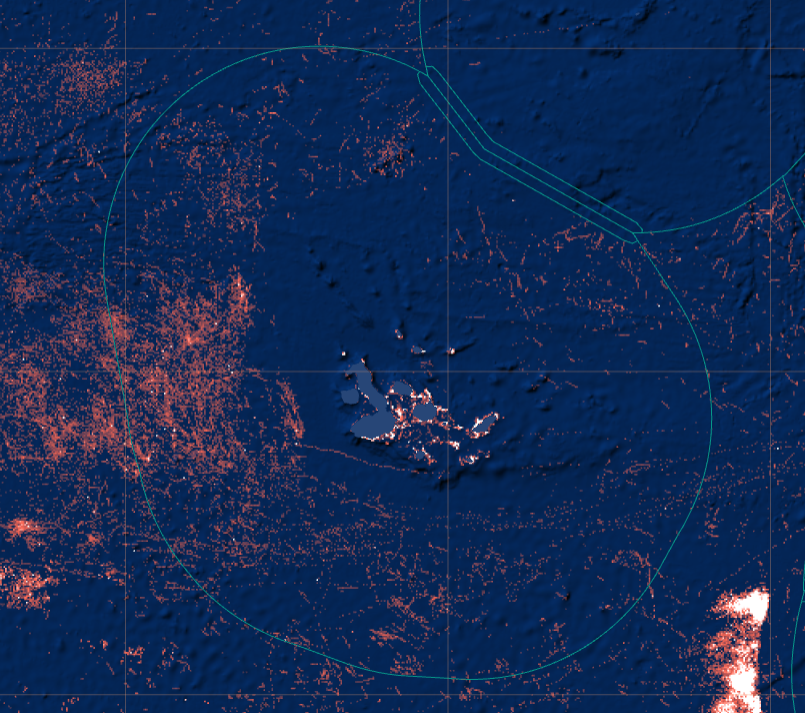

```{r libraries, message=FALSE, warning=FALSE, echo=F}
rm(list=ls())
require(here)
require(dplyr)
require(lubridate)
require(sf)
library(ggplot2)
library(ggthemes)
require(maps)
library(stringr)
library(rnaturalearth)
library(rnaturalearthdata)
require(gfwr)
```

# Global Fishing Watch

```{r fig.height=4, fig.width=4, echo=FALSE}
#| label: fig-GFWmap
#| fig-cap: "Imagen obtenida desde la plataforma GFW con datos de la actividad de pesca aparente en las cercanias de las Islas Galápagos."
#| fig-align: "center" # Optional alignment

# R code to generate a plot

```

Global Fishing Watch (GFW) es una organización no gubernamental (ONG) que busca
avanzar en la gobernanza de los océanos a través de una mayor transparencia de
la actividad humana en el mar. Al crear y compartir públicamente visualizaciones
de mapas, datos y herramientas de análisis, permiten la investigación científica
e impulsan una transformación en la forma en que gestiona el océano.

Global Fishing Watch genera nuevo conocimiento utilizando tecnología de punta
para convertir big data en información procesable. Comparten esa información
públicamente y de forma gratuita para acelerar la ciencia e impulsar políticas y
prácticas más justas e inteligentes que recompensen el buen comportamiento y
protejan la biodiversidad, la pesca y los medios de subsistencia.

Para más información sobre GFW en <http://www.globalfishingwatch.org>.

Mapa de visualización y acceso a datos <http://www.globalfishingwatch.org/map>.

# Datos

Global Fishing Watch (GFW) compila una gran cantidad de datos de posicionamiento 
de embarcaciones (AIS y VMS), registros de embarcaciones y otras infraestructuras 
marinas, y los pone a disposición de los usuarios a través de sus distintas 
plataformas. El acceso a estos datos e información es completamente gratuito y 
se puede realizar directamente a través de su [Plataforma WEB](http://www.globalfishingwatch.org/map),
[API](https://globalfishingwatch.org/es/nuestras-api/), [paquete de
R](https://github.com/GlobalFishingWatch/gfwr) y de [librería de
Python](https://pypi.org/project/gfw/).

Si bien la mayoría de los datos de GFW son gratuitos y de libre uso, para 
acceder a algunos de ellos es necesario crear una cuenta, proceso que también es
completamente gratuito. Para ello, se debe ingresar a la página principal de la
[plataforma](http://www.globalfishingwatch.org/map) de GFW y hacer clic en 
ícono de registro ({width="20"
height="22"}) ubicado en el extremo inferior izquierdo de la pantalla. Luego, 
se deben seguir los pasos del proceso de registro para obtener acceso a la 
descarga de datos.

Para este ejercicio, vamos a usar los datos de actividad de pesca aparente,
derivado de los dispositivos AIS, para los años 2023, 2024 y 2025, en la [zona
economica exclusiva que rodea las islas
Galápagos](https://globalfishingwatch.org/map/index?start=2024-08-12T00%3A00%3A00.000Z&end=2024-11-12T00%3A00%3A00.000Z&longitude=-87.53436510669711&latitude=-0.1438653714849388&zoom=5.3216383206620534&sbO=true&dvIn%5B0%5D%5Bid%5D=presence&dvIn%5B0%5D%5Bcfg%5D%5Bvis%5D=false&dvIn%5B1%5D%5Bid%5D=context-layer-eez&dvIn%5B1%5D%5Bcfg%5D%5Bvis%5D=true&dvIn%5B2%5D%5Bid%5D=vms&dvIn%5B2%5D%5Bcfg%5D%5Bvis%5D=false&dvIn%5B3%5D%5Bid%5D=ais&dvIn%5B3%5D%5Bcfg%5D%5Bvis%5D=true&tV=heatmap)
de la república del Ecuador, tanto como una serie de temporal diaria por barco y
por unidad espacial (0.01°x0.01°) .

## Descripción de los datos

Los datos temporales que vamos a utilizar en este ejercicio son las horas de
pesca aparente diaria por embarcación detectada dentro de esta área de interés.

Estos datos además contienen información acerca de las embarcaciones, con
nombre, numero IMO, MMSI, bandera, arte de pesca entre otros (@tbl-datosTS).

```{r}
#| label: tbl-datosTS
#| tbl-cap: >
#|    Datos temporales de esfuerzo aparente de pesca diaria para el año 2023. Los datos contienen además información de caracterización de las embarcaciones operando en la ZEE. 

data <- read.csv(here(
  "16-lunes",
  "DatosGFW",
  "datos",
  "Temporal_Ecuadorian Exclusive Economic Zone (Galapagos) - 2023-01-01T00_00_00.000Z,2024-01-01T00_00_00.000Z",
  "layer-activity-data-0",
  "public-global-fishing-effort-v5.0.csv"
))

knitr::kable(head(data))
```

En relación a los datos espaciales que se van a utilizar en este ejercicio son
las horas de actividad de pesca aparente diaria por unidad espacial de 
0.01°x0.01° de latitud y longitud (@tbl-datosSP).

```{r}
#| label: tbl-datosSP
#| tbl-cap: >
#|    Datos temporales de actividad aparente de pesca diaria para el año 2023. Los datos contienen además de la información de Latitud y Longitud, el país de origen y un identificador interno de la embarcación.

dataSP <- read.csv(here(
  "16-lunes",
  "DatosGFW",
  "datos",
  "Temporal_Ecuadorian Exclusive Economic Zone (Galapagos) - 2023-01-01T00_00_00.000Z,2024-01-01T00_00_00.000Z",
  "layer-activity-data-0",
  "public-global-fishing-effort-v5.0.csv"
))

knitr::kable(head(dataSP))
```

# Propuesta de Análisis

Los objetivos de este análisis serán:

1.  Identificar los países con mayor actividad de pesca en la ZEE de las islas
    galápagos.
2.  Identificar cuales son los artes de pesca que dominan la actividad de pesca 
    aparente dentro de la ZEE de las islas Galápagos.
3.  Obtener una serie temporal diaria de la actividad de pesca aparente.
    1.  Todos los países combinados.
    2.  Para los países principales.
4.  Identificar las zonas con mayor actividad de pesca.
5.  Identificar los periodos (meses) con mayor actividad de pesca.

# Configurar paquere gfwR

```{r eval=F}
# Check/install remotes
remotes::install_github("GlobalFishingWatch/gfwr",
                        dependencies = TRUE)
library(gfwr)
## https://globalfishingwatch.org/our-apis/tokens
## usethis::edit_r_environ()
#GFW_TOKEN="PASTE_YOUR_TOKEN_HERE"

#key <- gfw_auth()
#key <- Sys.getenv("GFW_TOKEN")
```

# Análisis Paso a paso

## Actividad de pesca aparente por país de registro

Para analizar los datos de pesca aparente por país de registro, tenemos que
agrupar los datos por país y sumar las horas de pesca aparente para cada uno de
ellos.

Esto lo vamos a hacer en dos pasos:

1.  Actividad acumulada de pesca aparente para todos los años por país, esto lo
    presentaremos en un gráfico.\
    1.1. Para esto primero usaremos la `gfw_ais_fishing_hours()` del paquete 
    `gfwR`. El API de GFW permite la descarta de datos de **hasta 1 
    año**, por lo que es necesario que dividamos la descarga para obtener los 3 
    años de interés.

```{r}
hp <- gfw_ais_fishing_hours(
      spatial_resolution = "HIGH",
      temporal_resolution = "DAILY",
      start_date = "2023-01-01",
      end_date = "2024-01-01",
      region_source = "EEZ",
      group_by = "FLAG",
      region = 8403 #(https://www.marineregions.org/eezdetails.php?mrgid=8403)
)
  
## Ahora un ejemplo de como hacer esto con un loop
hp2024_2025 <- data.frame()
for (i in 2024:2025)
{
  hp_temp <- gfw_ais_fishing_hours(
        spatial_resolution = "HIGH",
        temporal_resolution = "DAILY",
        start_date = (paste(i, "-01-01", sep="")),
        end_date = (paste(i+1, "-01-01", sep="")),
        region_source = "EEZ",
        group_by = "FLAG",
        region = 8403) #(https://www.marineregions.org/eezdetails.php?mrgid=8403)
  hp2024_2025 <- rbind(hp2024_2025, hp_temp)
}

data <- rbind(hp, hp2024_2025)
 
```
    
    1.2. Con los datos ya descargados, agrupamos todas las embarcaciones que 
    pertenecen al mismo país (`Flag`) y que son del mismo tipo (`Vessel Type`), 
    para luego sumar las  horas de pesca aparente (`Apparent Fishing Hours`).

```{r echo=TRUE}

hpAnual <- data %>%
  group_by(flag) %>% 
  summarise(hp = sum(`Apparent Fishing Hours`, na.rm=T))
  
```

Ahora que tenemos el número acumulado de horas podemos crear un gráfico usando
**ggplot**.

```{r fig.width=5, fig.height=3, echo=TRUE}
ggplot(hpAnual) +
  geom_col(aes(x=flag, y=hp)) +
  xlab("País") +
  ylab("Horas de pesca aparente (Hrs)") +
  scale_fill_discrete(name = "Tipo") +
  scale_colour_discrete(name = "Tipo") +
  ggthemes::theme_few() +
  theme(axis.text.x = element_text(angle = 45, hjust = 1)) 
```

2.  Actividad mensual de pesca aparente por de pesca por país y lo presentaremos
    en un gráfico.

    El proceso en este caso es similar, pero ahora se debe agrupar también por
    el `mes`. Para esto es necesario crear la columna **mes** y **year** (que
    usaremos más tarde), esto lo hacemos
    usando la funcion `dplr::mutate` y `lubridate::month`.

```{r fig.width=8, fig.height=5, echo=TRUE}

hpplot <- data %>%
  mutate(mes = month(`Time Range`),
         year = year(`Time Range`)) %>%  ## <- Obtenemos el mes desde la columna de la fecha
  group_by(mes, flag) %>% ## Incluimos el mes en el grouping
  summarise(hp = sum(`Apparent Fishing Hours`, na.rm=T))

ggplot(hpplot) +
  geom_col(aes(x=flag, y=hp)) +
  xlab("País") +
  ylab("Horas de pesca aparente (Hrs)") +
  scale_fill_discrete(name = "Tipo") +
  scale_colour_discrete(name = "Tipo") +
  ggthemes::theme_few() +
  theme(axis.text.x = element_text(angle = 45, hjust = 1)) +
  facet_wrap(~mes) ## <- Esto permite crear el grafico separando los meses
```


## Serie temporal de actividad diaria de pesca aparente

### Para todos los países

Ahora vamos a analizar cómo varía la actividad de pesca aparente a nivel diario. 
Para esto, compararemos primero la actividad total y luego la actividad por país.

En este caso, debemos agrupar la actividad de pesca aparente por día, sumando 
las horas individuales de cada embarcación. Posteriormente, podemos realizar 
este mismo análisis separando los datos por país y/o arte de pesca.

En los gráficos anteriores vimos que Ecuador es el país que presenta la mayor
actividad de pesca aparente en esta área. Por esta razón, utilizaremos únicamente
las embarcaciones ecuatorianas para este ejemplo. Para ello, filtraremos los 
datos utilizando la función `dplyr::filter`.

```{r}
hpDiaEcu <- data %>%
  filter(flag == "ECU") %>%  ## Aqui es donde filtramos para barcos de ecuador
  group_by(`Time Range`) %>% ## Incluimos el mes en el grouping
  summarise(hp = sum(`Apparent Fishing Hours`, na.rm=T))
```

Y como serie temporal.

```{r}
ggplot(hpDiaEcu) +
  geom_line(aes(x=as.Date(`Time Range`), y=hp), col="darkorange") +
  xlab("Fecha") +
  ylab("Horas de pesca aparente (Hrs)") +
  ggthemes::theme_few() +
  theme(axis.text.x = element_text(angle = 45, hjust = 1))

```

### Para los países principales

Ahora elaboraremos este gráfico temporal para los  países (excluido Ecuador)
que presentan la mayor actividad de pesca aparente en la ZEE de las islas Galápagos.

Para ello, necesitamos excluir las embarcaciones con bandera de Ecuador 
(`filter(Flag != "ECU")`) y aquellas sin bandera conocida (`!is.na(Flag)`).

Con estos datos, calculamos el total de horas de actividad de pesca aparente por
país.

```{r}
#| label: tbl-hpXPais
#| tbl-cap: >
#|    Horas de actividad aparente de pesca total por país.

porPais <- data %>%
  filter(flag != "ECU", flag != "",
         !is.na(flag)) %>%  ## Eliminamos embarcaciones de Ecuador y aquellas sin bandera
  group_by(flag) %>% ## Incluimos el mes en el grouping
  summarise(hp = sum(`Apparent Fishing Hours`, na.rm=T)) %>% 
  arrange(desc(hp))

knitr::kable(porPais)

```

En la @tbl-hpXPais vemos que la actividad de pesca aparente de Estados 
Unidos (USA), Reino Unido (GBR), España (ESP) y Tuvalu (TUV) son muy bajar y 
pueden corresponder a falsos positivos, es por esto que los eliminaremos del 
análisis.

```{r}
diaNoEcu <- data %>%
  filter(flag == c("PAN", "NIC" ,"CRI", "VEN", "PER")) %>%
  group_by(flag, `Time Range`) %>% 
  summarise(hp = sum(`Apparent Fishing Hours`, na.rm=T))
```

```{r}
ggplot(diaNoEcu) +
  geom_point(aes(x=as.Date(`Time Range`), y=hp, col = flag)) +
  geom_line(aes(x=as.Date(`Time Range`), y=hp, col = flag)) +
  xlab("Fecha") +
  ylab("Horas de actividad aparente (Hrs)") +
  ggthemes::theme_few() +
  theme(axis.text.x = element_text(angle = 45, hjust = 1)) +
  facet_wrap(~flag)
```


## Análisis espacial de la actividad de pesca aparente


### Zonas con mayor actividad de pesca aparente total anual

Aqui agrupamos los datos espaciales, sumando las horas de pesca aparente para
los 3 años, en cada una de las celdas y luego lo presentamos.

```{r}
spAnual <- data %>% 
  group_by(Lat, Lon) %>% 
  summarise(hp = sum(`Apparent Fishing Hours`, na.rm=T))

```

Y presentamos el mapa.

```{r}
ggplot(spAnual) +
  geom_tile(aes(x=Lon, y=Lat, z=hp))
```

Esta imágen se ve bastante mal, es necestio agregar las islas y, en términos
generales, mejorar la presentación.

```{r}
# Get Galapagos land data

spAnual_sf <- st_as_sf(spAnual, coords = c("Lon", "Lat"), crs = 4326) # Lo transforma a un                                                              objeto geográfico

galapagos_land <- ne_countries(scale = "medium", returnclass = "sf") %>%
  filter(name == "Ecuador")  # Filter for Ecuador, as Galapagos belongs to Ecuador

ggplot() +
  # Add base map
  geom_sf(data = galapagos_land, fill = "grey50", color = "black") +
  # Add fishing data
  geom_tile(data = spAnual, aes(x = Lon, y = Lat, fill = hp, col=hp)) +
  # Define color gradient
  scale_color_gradient(low = "darkblue", high = "red", name = "Horas", limits = c(0, 50)) +
  scale_fill_gradient(low = "darkblue", high = "red", name = "Horas", limits = c(0, 50)) +
  scale_size_continuous(name = "Horas de Actividad Aparente") +
  labs(
    title = "Actividad de Aparente en Galapagos EEZ",
    x = "Longitud",
    y = "Latitud"
  ) +
  theme_minimal() +
  coord_sf(xlim = c(-95.5, -85), ylim = c(-4.5, 4.5))  # Adjust limits to Galapagos region

```

### Zonas con mayor actividad de pesca aparente acumulada por año

El mismo gráfico, pero separado por años.

```{r fig.height=8, fig.width=8}
spMensual <- data %>% 
  mutate(year = year(`Time Range`)) %>% 
  group_by(year, Lat, Lon) %>% 
  summarise(hp = sum(`Apparent Fishing Hours`, na.rm=T))

ggplot() +
  geom_sf(data = galapagos_land, fill = "grey50", color = "black") +
  geom_tile(data = spMensual, aes(x = Lon, y = Lat, fill = hp, col=hp)) +
  scale_color_gradient(low = "darkblue", high = "red", name = "Horas", limits = c(0, 50)) +
  scale_fill_gradient(low = "darkblue", high = "red", name = "Horas", limits = c(0, 50)) +
  scale_size_continuous(name = "Horas de Actividad Aparente") +
  labs(
    title = "Actividad de Aparente en Galapagos EEZ",
    x = "Longitud", y = "Latitud" ) +
  theme_minimal() +
  coord_sf(xlim = c(-95.5, -85), ylim = c(-4.5, 4.5))  +# Adjust limits to Galapagos region
  facet_wrap(~year)
```
### Zonas por arte de pesca y año

Separados por arte de pesca y años.

```{r fig.height=8, fig.width=8}
spGTyYear <- data %>% 
  mutate(year = year(`Time Range`)) %>% 
  group_by(year,  Lat, Lon) %>% 
  summarise(hp = sum(`Apparent Fishing Hours`, na.rm=T))

ggplot() +
  geom_sf(data = galapagos_land, fill = "grey50", color = "black") +
  geom_tile(data = spGTyYear, aes(x = Lon, y = Lat, fill = hp, col=hp)) +
  scale_color_gradient(low = "darkblue", high = "red", name = "Horas", limits = c(0, 50)) +
  scale_fill_gradient(low = "darkblue", high = "red", name = "Horas", limits = c(0, 50)) +
  scale_size_continuous(name = "Horas de Actividad Aparente") +
  labs(
    title = "Actividad de Aparente en Galapagos EEZ",
    x = "Longitud", y = "Latitud" ) +
  theme_minimal() +
  coord_sf(xlim = c(-95.5, -85), ylim = c(-4.5, 4.5))  +# Adjust limits to Galapagos region
  facet_wrap(~year)
```

# Otras funciones de interés

## Presencia 

Si quisieramos conocer los potenciales riesgos de colición con mamíferos marinos
podriamos hacer algo como esto.

```{r}

aFiltrar <- c("speed = '10-15'", "speed = '15-25'",
              "speed = '>25'")

presSpeed <- data.frame()
  
for (i in aFiltrar)
{
temp <- gfw_ais_presence(spatial_resolution = "HIGH",
  temporal_resolution = "DAILY",
  start_date = "2026-01-01",
  end_date = "2026-07-01",
  region_source = "EEZ",
  group_by = "FLAG",
  region = 8403,
  key = gfw_auth(),
  filter_by = i)

presSpeed <- rbind(presSpeed, temp)
}

```

## Información de embarcaciones

```{r}
gfwr::gfw_vessel_info(query = 725000970, #as.vector(presSpeed$`Vessel ID`[1]),
                      search_type = "search")#$selfReportedInfo |> 
  #kableExtra::kable()


```


## Conocer los Regiones disponibles

```{r}
gfw_regions(region_source = "EEZ", key = gfw_auth()) |> 
    filter(iso == "CHL")

gfw_regions(region_source = "MPA", key = gfw_auth()) |> 
  filter(str_detect(label, "Juan Fernández")) |> 
  kableExtra::kable()

```

## Eventos

```{r}
gfw_event(
  event_type = "FISHING", #"ENCOUNTER", "GAP", "LOITERING", "PORT_VISIT",
  start_date = "2026-01-01",
  end_date = "2026-02-01",
  sort = "+start",
  #flags = "ECU",
  region_source = "EEZ",
  region = 8403
)[1:10,] |> kableExtra::kable()
```

