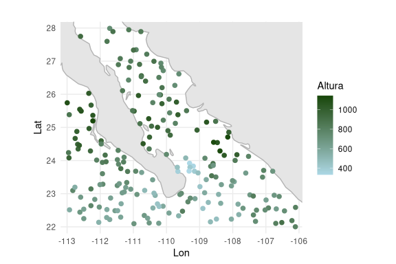
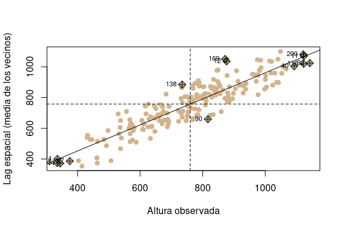
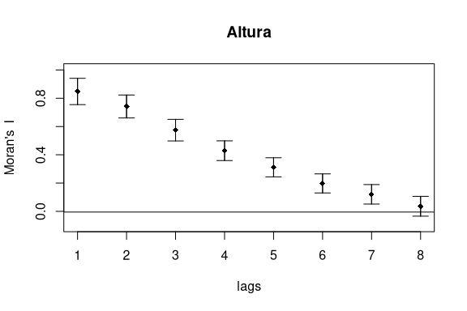
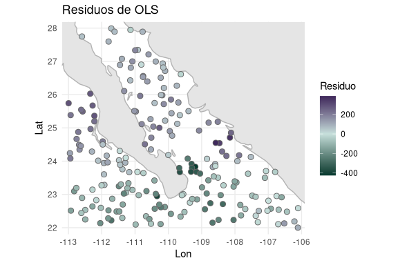

De la Autocorrelación a los Modelos Espaciales
================

## ¿Dónde nos quedamos?

En la charla
<a href="https://github.com/Intercoonecta/tutoriales/tree/main/11-miercoles/analisis_estadistico_R"
   style="color:#D1008F;"> Estadística descriptiva con datos
espaciales</a>: trabajamos con datos marinos de la costa de California y
vimos:

- Estadística descriptiva: histogramas, boxplots y gráficos de violín.

- Relaciones entre variables: gráficos de dispersión y correlaciones.

- Mapas de variables ambientales, cuantiles y representaciones
  bivariadas.

- Identificación de valores atípicos globales y locales.

  👽 Definición de vecinos por distancia y por proximidad.

  🏋️‍♀️ Matriz de pesos espaciales $W$.

  🗺️ Autocorrelación espacial Moran’s I: permite identificar
  asociaciones espaciales High-High, Low-Low, High-Low y Low-High.

### A los datos

El `csv` contiene información sobre algas en el Noroeste de México. Las
variables son: longitud, latitud, temperatura, clorofila y altura.

<!-- -->

### ¿A quién puedo considerar vecinos?

> ¿Cuáles opciones vimos?

Seguimos con `k-NN` con $k = 4$ y la matriz de pesos $W$
correspondiente.

``` r
# Cuatro vecinos más próximos

nb_knn <- knn2nb(knearneigh(coords, k = 4))

# Matriz de pesos estandarizada por filas: suma de los elementos de cada fila sea igual a 1. 
W <- nb2listw(nb_knn, style = "W")

# Vecinos de la primera observación
nb_knn[[1]]
```

    ## [1]  18  78 167 176

``` r
# W$neighbours[[1]] 

# Pesos asignados a esos vecinos
W$weights[[1]]
```

    ## [1] 0.25 0.25 0.25 0.25

``` r
# Valor observado y promedio de sus vecinos
dm$altura[1]
```

    ## [1] 674.3022

``` r
lag.listw(W, dm$altura)[1]
```

    ## [1] 708.5978

### Moran’s I global

> REcuerdan a LISA?

LISA permite identificar dónde se presentan asociaciones espaciales
locales. <!--LISA:  Local Indicators of Spatial Association -->

- **HH y LL:** observaciones rodeadas de vecinos con valores semejantes.
- **HL y LH:** observaciones diferentes de sus vecinos.

El Moran’s I global resume en **un solo número si los vecinos se
parecen**.

$H_0$: Ausencia de autocorrelación espacial global.

$H_a$: Existe autocorrelación espacial global (positiva o negativa).

``` r
#  moran.test(dm[,"temperatura"], W , alternative = "greater") #positiva. Default
  moran.test(dm[,"temperatura"], W, alternative = "less") #negativa 
```

    ## 
    ##  Moran I test under randomisation
    ## 
    ## data:  dm[, "temperatura"]  
    ## weights: W    
    ## 
    ## Moran I statistic standard deviate = -7.3416, p-value = 1.055e-13
    ## alternative hypothesis: less
    ## sample estimates:
    ## Moran I statistic       Expectation          Variance 
    ##      -0.346282941      -0.005025126       0.002160661

``` r
#  moran.test(dm[,"temperatura"], W, alternative = "two.side")  
moran.test(dm[,"clorofila"], W ) 
```

    ## 
    ##  Moran I test under randomisation
    ## 
    ## data:  dm[, "clorofila"]  
    ## weights: W    
    ## 
    ## Moran I statistic standard deviate = -0.39476, p-value = 0.6535
    ## alternative hypothesis: greater
    ## sample estimates:
    ## Moran I statistic       Expectation          Variance 
    ##      -0.023308077      -0.005025126       0.002144956

``` r
moran.test(dm[,"altura"], W ) 
```

    ## 
    ##  Moran I test under randomisation
    ## 
    ## data:  dm[, "altura"]  
    ## weights: W    
    ## 
    ## Moran I statistic standard deviate = 18.341, p-value < 2.2e-16
    ## alternative hypothesis: greater
    ## sample estimates:
    ## Moran I statistic       Expectation          Variance 
    ##       0.847943436      -0.005025126       0.002162744

⚠️ **Un resultado no significativo con `greater` (o `less`) no demuestra
ausencia de autocorrelación espacial.**

- Podría existir autocorrelación negativa (o positiva).

> ¿Cuál de las tres variables tiene más estructura espacial?

> ¿Cuál parece distribuirse al azar?

### Gráfico de dispersión de Moran.

``` r
moran.plot(dm$altura, listw = W, pch = 19, col = "tan",
           xlab = "Altura observada",
           ylab = "Lag espacial (media de los vecinos)")
```

<!-- -->

- Eje X: el valor de `altura` cada punto.
- Eje Y: la media de `altura` de sus vecinos.
- La pendiente de la recta es el Moran’s I.
- Los puntos marcados con un rombo y un número son observaciones
  influyentes.

> ¿Cómo se lee el gráfico?

- **Superior derecho (HH):** alturas altas rodeadas de alturas altas.
- **Inferior izquierdo (LL):** alturas bajas rodeadas de alturas bajas.
- **Inferior derecho (HL):** alturas altas rodeadas de alturas bajas.
- **Superior izquierdo (LH):** alturas bajas rodeadas de alturas altas.

> ¿Qué pasa si comparamos con puntos cada vez más lejanos?

### Correlogramas espaciales

Calcula Moran’s I para diferentes órdenes de vecindad y dibuja el
resultado.

- Orden 1: mis vecinos.
- Orden 2: los vecinos de mis vecinos.
- Y así sucesivamente.

> ¿Hasta qué distancia se parecen mis datos?

> Para diseñar un muestreo: ¿A qué distancia dos estaciones dejan de dar
> información repetida?

``` r
(cg_alt <- sp.correlogram(nb_knn, dm$altura, order = 8, method = "I",
                         style = "W", zero.policy = TRUE))
```

    ## Spatial correlogram for dm$altura 
    ## method: Moran's I
    ##           estimate expectation   variance standard deviate Pr(I) two sided    
    ## 1 (200)  0.8479434  -0.0050251  0.0021627          18.3413       < 2.2e-16 ***
    ## 2 (200)  0.7417331  -0.0050251  0.0016474          18.3982       < 2.2e-16 ***
    ## 3 (200)  0.5744172  -0.0050251  0.0014606          15.1618       < 2.2e-16 ***
    ## 4 (196)  0.4291180  -0.0051282  0.0012151          12.4577       < 2.2e-16 ***
    ## 5 (193)  0.3114401  -0.0052083  0.0011445           9.3598       < 2.2e-16 ***
    ## 6 (191)  0.1974440  -0.0052632  0.0011345           6.0182       1.764e-09 ***
    ## 7 (191)  0.1205177  -0.0052632  0.0011867           3.6512        0.000261 ***
    ## 8 (191)  0.0359161  -0.0052632  0.0012289           1.1747        0.240119    
    ## ---
    ## Signif. codes:  0 '***' 0.001 '**' 0.01 '*' 0.05 '.' 0.1 ' ' 1

``` r
plot(cg_alt, main = "Altura" , ylim=c(-0.1,1))
```

<!-- -->

<!-- 
- () cuántas observaciones tienen vecinos en ese orden de vecindad
- `estimate`: Moran's I en cada orden.
- `expectation`: valor esperado si no hubiera patrón espacial (casi 0).
- `Pr(I)`: p-valor. 
- plot:  el punto es el Moran's I y la barra es ± 2 desviaciones estándar. Si la barra no cruza la línea horizontal (valor esperado bajo H₀), sugiere autocorrelación espacial estadísticamente significativa.. -->

> ¿Hasta qué orden de vecindad hay autocorrelación en la altura?

> ¿Qué le cambiamos al código para ver el correlograma de la
> temperatura?

## Introducción a los modelos espaciales

### Regresiòn lineal `OLS`

$$
y_i = \beta_0 + \beta_1 x_i + \varepsilon_i,
\qquad \varepsilon_i \overset{iid}{\sim} N(0,\sigma^2)
$$

*iid* = independientes idénticamente distribuidos

> ¿La altura depende de la temperatura y de la clorofila?

``` r
fml <- altura ~ temperatura + clorofila
lm_1 <- lm(fml, data = dm)
summary(lm_1)
```

    ## 
    ## Call:
    ## lm(formula = fml, data = dm)
    ## 
    ## Residuals:
    ##     Min      1Q  Median      3Q     Max 
    ## -426.06 -114.31   10.98  111.42  388.62 
    ## 
    ## Coefficients:
    ##             Estimate Std. Error t value Pr(>|t|)    
    ## (Intercept)  281.635    117.103   2.405   0.0171 *  
    ## temperatura   13.278      4.280   3.102   0.0022 ** 
    ## clorofila     40.912      8.711   4.696 4.96e-06 ***
    ## ---
    ## Signif. codes:  0 '***' 0.001 '**' 0.01 '*' 0.05 '.' 0.1 ' ' 1
    ## 
    ## Residual standard error: 163 on 197 degrees of freedom
    ## Multiple R-squared:  0.147,  Adjusted R-squared:  0.1384 
    ## F-statistic: 16.98 on 2 and 197 DF,  p-value: 1.577e-07

> ¿Qué hipótesis contrastan estos p - valores?

> ¿Podemos confiar en ellos?

### Limitaciones ante la dependencia espacial

⚠️ La regresión `OLS` (ordinary least square) supone que los errores son
independientes.

🟰 **Pseudorreplicación espacial:** si las estaciones vecinas se
parecen, 200 observaciones pueden aportar menos información que 200
datos independientes.

      ➡️ ➡️ los errores estándar pueden subestimarse y los p-valores resultar demasiado optimistas.

🔀 **Posible sesgo:** si la altura de un sitio depende de la altura de
sus vecinos e ignoramos esa relación, los coeficientes también pueden
estar sesgados.

     🎯 No basta con detectar autocorrelación en la altura. Importa si persiste en los residuos, i.e., en lo que el modelo no explica. 

#### Gráfico de residuos

<!-- --> \> ¿Se
ve algún patrón espacial en los residuos?

Los residuos positivos y negativos tienden a agruparse espacialmente

#### TEst

$$
H_0: \text{No existe autocorrelación espacial en los residuos.}
$$

$$
H_a: \text{Existe autocorrelación espacial positiva en los residuos.}
$$

``` r
# Moran's I de los residuos
lm.morantest(lm_1, W)
```

    ## 
    ##  Global Moran I for regression residuals
    ## 
    ## data:  
    ## model: lm(formula = fml, data = dm)
    ## weights: W
    ## 
    ## Moran I statistic standard deviate = 19.515, p-value < 2.2e-16
    ## alternative hypothesis: greater
    ## sample estimates:
    ## Observed Moran I      Expectation         Variance 
    ##      0.905662810     -0.003223869      0.002169203

> ¿Qué dice el Moran’s I?

🎯 La regresión `OLS` no ha explicado toda la estructura espacial de los
datos.

## Tres modelos espaciales

Hay tres formas básicas de `meter` el espacio en una regresión. La
diferencia es dónde colocamos la dependencia:

🌀 SAR (Spatial Autoregressive Model): la respuesta de un sitio depende
de sus covariables y también de la altura de sus vecinos.

$$
y = \rho W y + X\beta + \varepsilon
$$

– P.e.: organismos que se dispersan entre sitios, un contaminante que se
propaga.

🌀 SEM (Spatial Error Model): la respuesta no depende de los vecinos,
pero nos faltan variables que sí tienen patrón espacial. Lo que no
medimos se queda en el error, y el error hereda el patrón.

$$
y = X\beta + u, \qquad u = \lambda W u + \varepsilon
$$

– P.e.: variables con estructura espacial que no medimos (corrientes,
batimetría, nutrientes).

🌀 SAC (Spatial Autoregressive Combined): combina los dos anteriores.

$$
y = \rho W y + X\beta + u, \qquad u = \lambda W u + \varepsilon
$$

Para los tres:

- $W y$ es la media de la respuesta en los vecinos (como vimos antes).
- $\rho$ y $\lambda$ miden la intensidad de la dependencia. Si valen 0,
  volvemos a la regresión convencional.
- $\varepsilon_i \overset{iid}{\sim} N(0,\sigma^2)$

### ¿Cuál elegir?

**Primero el contexto del problema, después la estadística:**

– Si existe un mecanismo de dispersión o transporte entre sitios, `SAR`

– Si sospechamos de variables no medidas con estructura espacial, `SEM`.

**Pruebas de multiplicadores de Lagrange (LM)** parten de la regresión
clásica y preguntan:

❓ ¿Existe evidencia para incorporar la dependencia espacial en la
respuesta (SAR)? $$
H_0:\rho=0 \qquad H_a:\rho\neq 0
$$

❓ ¿Existe evidencia para incorporarla en los errores (SEM)?

$$
H_0:\lambda=0 \qquad H_a:\lambda\neq 0
$$

❓ ¿Existe evidencia conjunta de dependencia espacial (SARMA)? SARMA:
Spatial AutoRegressive Moving Average.

$$
H_0:\rho=\lambda=0
\qquad
H_a:\rho\neq 0 \;\text{o}\; \lambda\neq 0
$$

⚠️ Estas pruebas suponen errores normales y con variabilidad constante.

``` r
summary(lm.RStests(lm_1, W, test = "all"))
```

    ##  Rao's score (a.k.a Lagrange multiplier) diagnostics for spatial
    ##  dependence
    ## data:  
    ## model: lm(formula = fml, data = dm)
    ## test weights: W
    ##  
    ##           statistic parameter   p.value    
    ## RSerr    370.723220         1 < 2.2e-16 ***
    ## RSlag    393.428910         1 < 2.2e-16 ***
    ## adjRSerr   0.036786         1    0.8479    
    ## adjRSlag  22.742475         1 1.852e-06 ***
    ## SARMA    393.465696         2 < 2.2e-16 ***
    ## ---
    ## Signif. codes:  0 '***' 0.001 '**' 0.01 '*' 0.05 '.' 0.1 ' ' 1

- `RSlag`: evalúa la dependencia espacial en la respuesta.
- `RSerr`: evalúa la dependencia espacial en los errores.
- `adjRSlag` y `adjRSerr`: versiones ajustadas que consideran la posible
  presencia del otro tipo de dependencia.
- `SARMA`: prueba conjunta de dependencia espacial.

> ¿Qué modelo sugieren las pruebas?

🎯 Las pruebas favorecen un modelo `SAR`, que será necesario ajustar y
evaluar.

### Ajuste de `SAR`, `SEM` y `SAC`

``` r
# REcordar que fml: altura ~ temperatura + clorofila
m_sar <- lagsarlm(fml,   data = dm, listw = W)   # SAR
m_sem <- errorsarlm(fml, data = dm, listw = W)   # SEM
m_sac <- sacsarlm(fml,   data = dm, listw = W)   # SAC

summary(m_sar)
```

    ## 
    ## Call:lagsarlm(formula = fml, data = dm, listw = W)
    ## 
    ## Residuals:
    ##       Min        1Q    Median        3Q       Max 
    ## -134.8802  -33.4083   -3.1488   31.4310  105.8907 
    ## 
    ## Type: lag 
    ## Coefficients: (asymptotic standard errors) 
    ##              Estimate Std. Error z value  Pr(>|z|)
    ## (Intercept) -435.4774    36.4128 -11.960 < 2.2e-16
    ## temperatura   15.9950     1.2078  13.243 < 2.2e-16
    ## clorofila     27.4850     2.4731  11.114 < 2.2e-16
    ## 
    ## Rho: 0.9014, LR test value: 442.09, p-value: < 2.22e-16
    ## Asymptotic standard error: 0.017837
    ##     z-value: 50.536, p-value: < 2.22e-16
    ## Wald statistic: 2553.9, p-value: < 2.22e-16
    ## 
    ## Log likelihood: -1079.979 for lag model
    ## ML residual variance (sigma squared): 2102, (sigma: 45.848)
    ## Number of observations: 200 
    ## Number of parameters estimated: 5 
    ## AIC: 2170, (AIC for lm: 2610)
    ## LM test for residual autocorrelation
    ## test value: 0.70859, p-value: 0.39991

#### El modelo `SAR` ajustado es:

$$
\widehat{\text{altura}}_i = -435.48 + 16\,\text{temperatura}_i + 27.48\,\text{clorofila}_i + 0.901\sum_j w_{ij}\text{altura}_j
$$

- `Coefficients`: temperatura y clorofila presentan coeficientes
  positivos y significativos.

> ¿Es $\rho$ distinto de 0?

- `Rho: 0.9014`, `z-value: 50.536, p-value: < 2.22e-16`: indica una
  dependencia espacial positiva muy intensa y estadísticamente
  significativa.

- `LR test value: 442.09, p-value: < 2.22e-16`: compara `SAR` con `OLS`.
  Existe evidencia de que incorporar el rezago espacial mejora el ajuste
  del modelo.

> ¿Queda autocorrelación espacial en los errores del SAR?

- `LM test for residual autocorrelation test value: 0.70859, p-value: 0.39991`:
  evalúa si queda dependencia espacial en los errores del SAR. A
  $\alpha=0.05$ no hay evidencia estadísticamente significativa de
  autocorrelación espacial residual.

### Comparación de modelos

``` r
mods <- list(OLS = lm_1, SAR = m_sar, SEM = m_sem, SAC = m_sac)

comp <- data.frame(
  temperatura = sapply(mods, function(m) coef(m)["temperatura"]),
  clorofila   = sapply(mods, function(m) coef(m)["clorofila"]),
  rho         = c(NA, m_sar$rho, NA, m_sac$rho),
  lambda      = c(NA, NA, m_sem$lambda, m_sac$lambda),
  AIC         = sapply(mods, AIC),
  I_residuos  = sapply(mods, function(m) moran.test(residuals(m), W,  alternative = "two.sided")$estimate[1]), 
  p_residuos  = sapply(mods, function(m)
    moran.test(residuals(m), W, alternative = "two.sided")$p.value),
    row.names   = names(mods)
)

round(comp, 2)
```

    ##     temperatura clorofila  rho lambda     AIC I_residuos p_residuos
    ## OLS       13.28     40.91   NA     NA 2610.05       0.91       0.00
    ## SAR       16.00     27.48 0.90     NA 2169.96       0.03       0.46
    ## SEM       11.81     22.73   NA   0.92 2182.95       0.01       0.68
    ## SAC       15.99     27.84 0.89   0.12 2171.26       0.00       0.93

- `AIC`: cuanto más bajo, mejor equilibrio entre ajuste y complejidad.

- `I_residuos`: Moran’s I de los residuos. Valores cercanos a `cero`
  sugieren poca autocorrelación espacial residual.

> ¿Hay diferencias entre modelos?

🎯 Los coeficientes cambian, especialmente el de clorofila (40.91 en
`OLS` y 27.48 en `SAR`). 🎯 Los errores estándar disminuyen
(temperatura: 4.28 en `OLS` y 1.21 en `SAR`).

    ➡️  Incorporar la dependencia espacial modifica la incertidumbre de las estimaciones

🎯 `SAR` presenta el menor `AIC` y reduce la autocorrelación residual
respecto a `OLS`

🎯 `SAC` ofrece un ajuste equivalente según el `AIC`, pero con un
parámetro de más.

     ➡️ `SAR` es una opción razonable.

### Interpretación de los coeficientes del SAR

😀 En `OLS`, el coeficiente de temperatura indica cuánto cambia, en
promedio, la altura por cada unidad adicional de temperatura,
manteniendo constantes las demás variables.

🤯 En `SAR`, los cambios pueden propagarse entre estaciones y regresar a
la estación de origen a través de sus vecinos.

- Por eso, el coeficiente de temperatura 15.995 no representa el efecto
  completo: si aumenta la temperatura en una estación, cambia su altura;
  ese cambio afecta la altura de sus vecinos y, a su vez, puede regresar
  a la estación de origen.

➡️ Tres tipos de impactos:

- Directo: cambio en la altura de la propia estación, incluyendo el
  efecto que regresa a través de sus vecinos.

- Indirecto (spillover): cambio en la altura de otras estaciones debido
  al aumento de temperatura en una estación.

- Total: suma de los dos anteriores.

``` r
(imp_sar <- impacts(m_sar, listw = W))
```

    ## Impact measures (lag, exact):
    ##                     Direct Indirect    Total
    ## temperatura dy/dx 26.18207 136.0351 162.2172
    ## clorofila dy/dx   44.98985 233.7554 278.7453

> ¿Qué parte del efecto de la temperatura llega a través de los vecinos?

- Si la temperatura aumenta una unidad en todas las estaciones, la
  altura aumenta, en promedio, 162.22 unidades.
- 
- De ese cambio, 26.18 corresponden al efecto directo en cada estación y
  136.04 al efecto indirecto transmitido entre estaciones.

🎯 El efecto total es mayor que el coeficiente estimado (16), debido a
la propagación espacial.

🚧 En el SEM no hace falta: los coeficientes se interpretan
directamente.

### ¿Cuándo es necesario considerar modelos espaciales?

- Cuando los residuos de `OLS` tienen autocorrelación espacial.
- Cuando existe un mecanismo que conecta los sitios vecinos (dispersión,
  transporte, contagio).
  <!-- - No siempre hace falta: a veces una covariable explica el patrón espacial (la temperatura y la latitud). -->

#### check list

- Mapa de la variable.
- Moran’s I y correlograma.
- Regresión `OLS`.
- Moran’s I de los residuos y pruebas de multiplicadores de Lagrange.
- Modelo espacial.
- Comparación y revisión de los residuos.

#### Principales decisiones metodológicas

- Quién es vecino de quién: k-NN, distancia y número de vecinos.
- Qué modelo: SAR, SEM o SAC.
- Qué hacer si la variabilidad cambia entre zonas.

> ¿Qué más puedo hacer?

- Geoestadística: variogramas y kriging para predecir en sitios no
  muestreados.
- Regresión geográficamente ponderada (GWR): coeficientes que cambian en
  el espacio.
- Modelos espacio-temporales.
